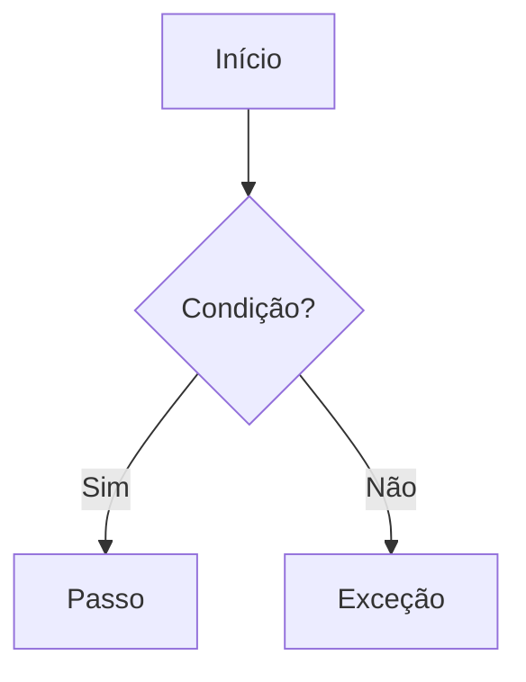

# Cabeçalho
| Campo | Valor |
|---|---|
| Documento | Fluxo — {Assunto} |
| Código | {COD} |
| Status | Rascunho / Em revisão / Aprovado |
| Versão | 0.1 |
| Atualizado em | AAAA-MM-DD |
| Responsável | {nome} |
| Relacionados | [negocio-{assunto}.md](../negocio-{assunto}.md), [tecnico-{assunto}.md](../tecnico/tecnico-{assunto}.md) |

# 1. Objetivo
O que o usuário quer alcançar com este fluxo, em 1 a 3 frases.

# 2. Atores
| Ator | Papel no fluxo |
|---|---|
| {Ator} | {Inicia / participa / aprova} |

# 3. Pré-condições
O que precisa ser verdade **antes** de o fluxo começar (ex.: usuário logado, conta ativa).

# 4. Gatilho
O que inicia o fluxo (ex.: clique em "Sou novo por aqui", acesso ao link do convite).

# 5. Fluxo principal
O caminho feliz, passo a passo. Cada passo diz **quem** faz **o quê**.

| Passo | Quem | Ação |
|---|---|---|
| P1 | Usuário | {ação} |
| P2 | Sistema | {resposta} |

# 6. Fluxos alternativos
Caminhos válidos diferentes do principal.

| ID | A partir de | Condição | O que acontece |
|---|---|---|---|
| A1 | P{N} | {condição} | {comportamento} — volta para P{N} / encerra |

# 7. Fluxos de exceção
Erros e bloqueios.

| ID | A partir de | Condição | O que acontece | Mensagem |
|---|---|---|---|---|
| E1 | P{N} | {erro} | {comportamento} | MSG-{COD}-01 |

# 8. Diagrama

# 9. Regras do fluxo
| ID | Regra |
|---|---|
| RF-{COD}-01 | {Regra que vale durante o fluxo} |

# 10. Mensagens ao usuário
Toda mensagem deve ser curta, clara e amigável.

| ID | Situação | Texto sugerido |
|---|---|---|
| MSG-{COD}-01 | {quando aparece} | "{texto}" |

# 11. Pós-condições
O que fica verdadeiro **depois** que o fluxo termina com sucesso (ex.: conta criada com status "inativa").

# 12. Pendências e pontos a especificar
| ID | Ponto | Por que importa | Sugestão |
|---|---|---|---|
| PEND-{COD}-01 | {Dúvida ou lacuna} | {Impacto} | {Proposta} |

## Pendências resolvidas
| ID | Decisão | Data |
|---|---|---|
| PEND-{COD}-NN | {O que foi decidido} | AAAA-MM-DD |

# 13. Histórico
| Data | Versão | Alteração | Autor |
|---|---|---|---|
| AAAA-MM-DD | 0.1 | Criação | {nome} |
