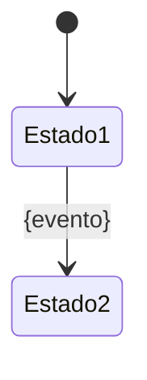

# Cabeçalho
| Campo | Valor |
|---|---|
| Documento | Técnico — {Assunto} |
| Código | {COD} |
| Status | Rascunho / Em revisão / Aprovado |
| Versão | 0.1 |
| Atualizado em | AAAA-MM-DD |
| Responsável | {nome} |
| Relacionados | [negocio-{assunto}.md](../negocio-{assunto}.md), [fluxo-{assunto}.md](../fluxo/fluxo-{assunto}.md) |

# 1. Objetivo
Quais dados e restrições técnicas este documento especifica.

# 2. Dados
Uma tabela por grupo de dados. A coluna **LGPD** indica se é dado pessoal (`Pessoal`), dado pessoal que exige proteção reforçada (`Sensível`) ou não (`—`).

## 2.1. {Grupo}
| Campo | Tipo | Obrigatório | Tamanho | Formato / validação | LGPD | Observação |
|---|---|---|---|---|---|---|
| {campo} | Texto / Número / Data / Data e hora / Booleano / Lista | Sim / Não / Condicional | mín–máx | {regra} | Pessoal / Sensível / — | {nota} |

# 3. Estados
Quando a entidade tem ciclo de vida, liste os estados e as transições.

| Estado | Significado | Vai para |
|---|---|---|
| {estado} | {significado} | {próximos estados} |

# 4. Regras técnicas
| ID | Regra |
|---|---|
| RT-{COD}-01 | {Regra verificável} |

# 5. Validações
Onde cada validação acontece. O backend **sempre** valida; o frontend valida para a experiência do usuário.

| Validação | Frontend | Backend |
|---|---|---|
| {validação} | ✅ | ✅ |

# 6. Rotinas, integrações e eventos
Rotinas agendadas, serviços externos (e-mail, SMS, busca de CEP) e eventos gerados.

| Item | Tipo | Descrição |
|---|---|---|
| {nome} | Rotina / Integração / Evento | {descrição} |

# 7. Segurança e LGPD
Como os dados são protegidos: criptografia, mascaramento, retenção, auditoria, limites de tentativas.

# 8. Pendências e pontos a especificar
| ID | Ponto | Por que importa | Sugestão |
|---|---|---|---|
| PEND-{COD}-01 | {Dúvida ou lacuna} | {Impacto} | {Proposta} |

## Pendências resolvidas
| ID | Decisão | Data |
|---|---|---|
| PEND-{COD}-NN | {O que foi decidido} | AAAA-MM-DD |

# 9. Histórico
| Data | Versão | Alteração | Autor |
|---|---|---|---|
| AAAA-MM-DD | 0.1 | Criação | {nome} |
