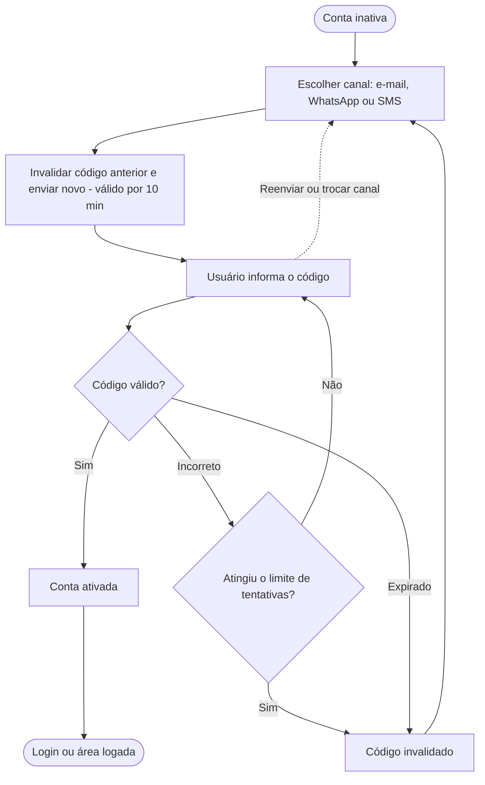

# Cabeçalho
| Campo | Valor |
|---|---|
| Documento | Fluxo — Ativação de cadastro |
| Código | ATV |
| Status | Rascunho |
| Versão | 0.3 |
| Atualizado em | 2026-11-13 |
| Responsável | A definir |
| Relacionados | [negocio-cadastro.md](../negocio-cadastro.md), [fluxo-cadastro.md](fluxo-cadastro.md), [fluxo-login.md](fluxo-login.md), [tecnico-login.md](../tecnico/tecnico-login.md) |

# 1. Objetivo
Confirmar que o contato informado pertence ao usuário, por meio de um código de validação, e ativar a conta.

# 2. Atores
| Ator | Papel no fluxo |
|---|---|
| Usuário com conta inativa | Escolhe o canal e informa o código. |
| Sistema | Gera, envia e valida o código e ativa a conta. |

# 3. Pré-condições
- A conta existe e está **inativa**.

# 4. Gatilho
- Tentativa de login com a conta inativa (ver [fluxo-login.md](fluxo-login.md), exceção E4).
- **[SUGESTÃO]** Conclusão do cadastro (ver [fluxo-cadastro.md](fluxo-cadastro.md), P11). **[PENDENTE: PEND-CAD-11]**

# 5. Fluxo principal
| Passo | Quem | Ação |
|---|---|---|
| P1 | Sistema | Identifica que a conta está inativa e abre a tela de validação. |
| P2 | Sistema | Pergunta para onde enviar o código: e-mail, WhatsApp ou SMS. Se o telefone cadastrado for **fixo**, as opções de WhatsApp e SMS aparecem indisponíveis, com o aviso MSG-ATV-06 (RF-ATV-11). **[SUGESTÃO]** Mostra os contatos mascarados (ex.: `je***@gmail.com`, `(11) *****-1234`). |
| P3 | Usuário | Escolhe o canal. |
| P4 | Sistema | Invalida qualquer código anterior, gera um novo código válido por 10 minutos e o envia pelo canal escolhido. |
| P5 | Usuário | Informa o código recebido. |
| P6 | Sistema | Valida o código e ativa a conta. |
| P7 | Sistema | Informa que a conta foi ativada e **[PENDENTE: PEND-ATV-02]** leva o usuário para o login ou para a área logada. |

# 6. Fluxos alternativos
| ID | A partir de | Condição | O que acontece |
|---|---|---|---|
| A1 | P5 | O usuário pede um novo código. | **[SUGESTÃO]** Depois de 60 segundos do último envio, o sistema volta ao P4: o código anterior é invalidado e um novo é enviado. |
| A2 | P5 | O usuário quer trocar de canal. | Volta ao P2. O código anterior é invalidado no novo envio. |

# 7. Fluxos de exceção
| ID | A partir de | Condição | O que acontece | Mensagem |
|---|---|---|---|---|
| E1 | P6 | Código incorreto. | A conta continua inativa; o usuário pode tentar de novo. | MSG-ATV-01 |
| E2 | P6 | Código expirado (mais de 10 minutos). | O código é recusado; o sistema oferece o envio de um novo. | MSG-ATV-02 |
| E3 | P6 | **[SUGESTÃO]** Limite de tentativas incorretas atingido (5 por código). | O código é invalidado; é preciso pedir um novo. | MSG-ATV-03 |
| E4 | P4 | Falha no envio pelo canal escolhido. | O sistema oferece outro canal. | MSG-ATV-04 |
| E5 | P2 | O telefone cadastrado é fixo. | O usuário não recebe código por SMS nem por WhatsApp: essas opções ficam indisponíveis, e só o e-mail pode ser usado. | MSG-ATV-06 |

# 8. Diagrama

# 9. Regras do fluxo
| ID | Regra |
|---|---|
| RF-ATV-01 | Só é possível logar com a conta ativa (ver [fluxo-login.md](fluxo-login.md)). **[AJUSTE]** |
| RF-ATV-02 | O código de validação expira 10 minutos após o envio. |
| RF-ATV-03 | Cada usuário só pode ter um código válido por vez. |
| RF-ATV-04 | Ao enviar um novo código, o anterior é invalidado. |
| RF-ATV-05 | Uma rotina invalida os códigos que passaram do prazo de validade. |
| RF-ATV-06 | **[SUGESTÃO]** O código tem 6 dígitos numéricos, gerados de forma aleatória. |
| RF-ATV-07 | **[SUGESTÃO]** São permitidas até 5 tentativas incorretas por código. |
| RF-ATV-08 | **[SUGESTÃO]** O reenvio só é permitido 60 segundos depois do último envio, com no máximo 5 envios por hora. |
| RF-ATV-09 | **[SUGESTÃO]** O canal usado na ativação fica marcado como **verificado**. **[PENDENTE: PEND-ATV-01]** |
| RF-ATV-10 | Todas as mensagens são curtas, claras e amigáveis. |
| RF-ATV-11 | Com telefone **fixo**, o usuário não recebe código por SMS nem por WhatsApp. Essas opções não podem ser escolhidas, e o código só pode ser enviado por e-mail. O tipo de telefone é definido em [tecnico-cadastro.md](../tecnico/tecnico-cadastro.md) (RT-CAD-11). |

# 10. Mensagens ao usuário
| ID | Situação | Texto sugerido |
|---|---|---|
| MSG-ATV-01 | Código incorreto | "Código incorreto. Confira e tente de novo." |
| MSG-ATV-02 | Código expirado | "Esse código expirou. Vamos enviar um novo?" |
| MSG-ATV-03 | Limite de tentativas | "Muitas tentativas. Peça um novo código para continuar." |
| MSG-ATV-04 | Falha no envio | "Não conseguimos enviar o código por aqui. Tente outro canal." |
| MSG-ATV-05 | Conta ativada | "Tudo certo! Sua conta está ativa." |
| MSG-ATV-06 | Telefone fixo | "Seu telefone é fixo e não recebe SMS nem WhatsApp. Enviaremos o código por e-mail." |

# 11. Pós-condições
- A conta está **ativa**.
- Nenhum código válido permanece para o usuário.
- O canal usado está marcado como verificado (se RF-ATV-09 for aprovada).

# 12. Pendências e pontos a especificar
| ID | Ponto | Por que importa | Sugestão |
|---|---|---|---|
| PEND-ATV-01 | Se a ativação for por SMS, o e-mail fica sem verificação (e vice-versa). Os dois contatos precisam ser verificados? | O e-mail e o telefone são usados na recuperação de senha; um contato não verificado pode ser de outra pessoa. | Exigir um canal para ativar e pedir a verificação do outro no primeiro acesso, sem bloquear. |
| PEND-ATV-02 | Depois de ativar, o usuário entra direto ou precisa fazer login? | Experiência do usuário. | Se a ativação veio do login, entrar direto; se veio do cadastro, também entrar direto, já que a senha acabou de ser criada. |
| PEND-ATV-03 | Confirmar os limites sugeridos (tamanho do código, tentativas e reenvios). | Proteção contra abuso e contra custo alto de SMS/WhatsApp. | Valores das regras RF-ATV-06 a RF-ATV-08. |
| PEND-ATV-04 | Qual provedor envia SMS e WhatsApp? Existe orçamento? | Custo por mensagem e necessidade de conta comercial do WhatsApp. | Começar com e-mail e SMS e incluir o WhatsApp depois. |

## Pendências resolvidas
| ID | Decisão | Data |
|---|---|---|
| PEND-ATV-05 | O telefone pode ser fixo. Com telefone fixo, o usuário não recebe código por SMS nem por WhatsApp; só o e-mail fica disponível (RF-ATV-11). | 2026-11-13 |

# 13. Histórico
| Data | Versão | Alteração | Autor |
|---|---|---|---|
| — | 0.1 | Criação | Autor original |
| 2026-11-13 | 0.2 | Padronização no modelo de fluxo; passos; exceções; diagrama; mensagens; pendências. **[AJUSTE]** RF-ATV-01: a referência apontava para o próprio documento (`fluxo-ativacao-cadastro.md`); corrigida para `fluxo-login.md`. | Claude |
| 2026-11-13 | 0.3 | Resolvida PEND-ATV-05: com telefone fixo, SMS e WhatsApp ficam indisponíveis (RF-ATV-11, MSG-ATV-06). P2 e E5 atualizados. | Claude |
