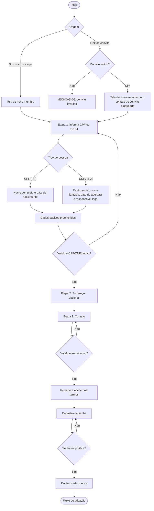

# Cabeçalho
| Campo | Valor |
|---|---|
| Documento | Fluxo — Cadastro de usuário |
| Código | CAD |
| Status | Rascunho |
| Versão | 0.3 |
| Atualizado em | 2026-11-13 |
| Responsável | A definir |
| Relacionados | [negocio-cadastro.md](../negocio-cadastro.md), [tecnico-cadastro.md](../tecnico/tecnico-cadastro.md), [fluxo-convite.md](fluxo-convite.md), [fluxo-ativacao-cadastro.md](fluxo-ativacao-cadastro.md) |

# 1. Objetivo
Permitir que uma pessoa crie a sua conta no Kasa, de forma espontânea ou a partir de um convite.

# 2. Atores
| Ator | Papel no fluxo |
|---|---|
| Visitante | Inicia o cadastro espontâneo. |
| Convidado | Inicia o cadastro pelo link do convite. |
| Sistema | Valida os dados, cria a conta e inicia a ativação. |

# 3. Pré-condições
- **Cadastro espontâneo:** nenhuma.
- **Cadastro por convite:** o convite existe e não está expirado nem já utilizado (ver [fluxo-convite.md](fluxo-convite.md)).

# 4. Gatilho
- **Espontâneo:** clique no link "Sou novo por aqui".
- **Convite:** acesso ao link recebido no convite.

# 5. Fluxo principal (cadastro espontâneo)
| Passo | Quem | Ação |
|---|---|---|
| P1 | Visitante | Acessa a plataforma e clica no link "Sou novo por aqui". |
| P2 | Sistema | Abre a tela de novo membro, dividida em três etapas: **Dados básicos**, **Endereço** e **Contato**. Só a primeira etapa começa liberada. |
| P3 | Visitante | Informa o CPF ou o CNPJ. **[AJUSTE]** |
| P3.1 | Sistema | Identifica o tipo de pessoa pelo documento e mostra os campos correspondentes: **PF** (nome completo e data de nascimento) ou **PJ** (razão social, nome fantasia, data de abertura e responsável legal). Ver [negocio-cadastro.md](../negocio-cadastro.md), seções 5.2 e 5.3. |
| P3.2 | Visitante | Preenche os demais dados básicos. |
| P4 | Sistema | Valida a etapa (frontend e backend) e libera a etapa seguinte. |
| P5 | Visitante | Preenche o endereço ou avança sem preenchê-lo, já que o endereço é opcional. **[AJUSTE]** |
| P6 | Sistema | Se o endereço foi informado, valida a etapa. Libera a etapa de contato. |
| P7 | Visitante | Preenche o contato: telefone e e-mail. |
| P8 | Sistema | Valida a etapa. |
| P9 | Visitante | **[SUGESTÃO]** Revisa um resumo dos dados, aceita os Termos de Uso e a Política de Privacidade e envia o formulário. |
| P10 | Visitante | Cadastra a senha e a confirmação, conforme a política de senha de [tecnico-login.md](../tecnico/tecnico-login.md). **[AJUSTE]** |
| P11 | Sistema | Cria a conta com status **inativa** e inicia o fluxo de [ativação de cadastro](fluxo-ativacao-cadastro.md). **[PENDENTE: PEND-CAD-11]** |

# 6. Fluxos alternativos
| ID | A partir de | Condição | O que acontece |
|---|---|---|---|
| A1 | P3–P9 | O usuário volta a uma etapa já preenchida. | Os dados preenchidos são mantidos. Ele pode navegar entre as etapas liberadas sem perder informação. |
| A2 | P3–P9 | O usuário altera um dado já preenchido. | A etapa é validada novamente. Se um campo obrigatório ficar inválido, as etapas seguintes voltam a ser bloqueadas até a correção. |
| A3 | P5 | **[SUGESTÃO]** O usuário informa um CEP válido. | O sistema preenche logradouro, bairro, cidade e UF automaticamente (consulta pelo backend). O usuário pode corrigir. |
| A4 | — | **Cadastro por convite:** o convidado acessa o link do convite. | O sistema valida o convite e abre a mesma tela do P2, com o dado de contato do convite (e-mail ou celular) já preenchido e **bloqueado para edição**. O fluxo segue do P3. **[PENDENTE: PEND-CAD-10]** |

# 7. Fluxos de exceção
| ID | A partir de | Condição | O que acontece | Mensagem |
|---|---|---|---|---|
| E1 | P4, P6, P8 | Campo obrigatório vazio ou inválido. | A etapa seguinte continua bloqueada; o erro aparece junto ao campo. | MSG-CAD-01 |
| E2 | P4 | CPF ou CNPJ já cadastrado. | O cadastro não continua; o sistema oferece os links para login e para recuperação de senha. **[PENDENTE: PEND-CAD-12]** | MSG-CAD-02 |
| E3 | P8 | E-mail já cadastrado. | O cadastro não continua. **[PENDENTE: PEND-CAD-12]** | MSG-CAD-03 |
| E4 | P10 | A senha não atende à política, ou a confirmação não confere. | A senha não é aceita; a regra não atendida é indicada. | MSG-CAD-04 |
| E5 | A4 | Convite expirado, já utilizado ou inexistente. | A tela de cadastro não abre; o sistema oferece o cadastro espontâneo. | MSG-CAD-05 |
| E6 | P2–P10 | O usuário fecha a tela antes de concluir. | **[PENDENTE: PEND-CAD-09]** | — |

# 8. Diagrama

# 9. Regras do fluxo
| ID | Regra |
|---|---|
| RF-CAD-01 | As etapas começam bloqueadas e são liberadas conforme os campos obrigatórios da etapa anterior são preenchidos e validados. |
| RF-CAD-02 | É possível navegar entre as etapas liberadas sem perder as informações preenchidas. |
| RF-CAD-03 | É possível alterar o que já foi preenchido, e os campos obrigatórios são sempre validados novamente. |
| RF-CAD-04 | Cada etapa é validada no frontend e no backend. |
| RF-CAD-05 | O formulário só pode ser enviado com todas as etapas obrigatórias válidas. |
| RF-CAD-06 | No cadastro por convite, o dado de contato do convite aparece preenchido e não pode ser alterado. |
| RF-CAD-07 | O link de convite só é aceito se não estiver expirado (validade de 7 dias, ver [fluxo-convite.md](fluxo-convite.md)). |
| RF-CAD-08 | A senha segue a política definida em [tecnico-login.md](../tecnico/tecnico-login.md). **[AJUSTE]** |
| RF-CAD-09 | Ao concluir, a conta é criada inativa e só pode ser usada depois da ativação. |
| RF-CAD-10 | Todas as mensagens são curtas, claras e amigáveis. |

# 10. Mensagens ao usuário
| ID | Situação | Texto sugerido |
|---|---|---|
| MSG-CAD-01 | Campo inválido | Mensagem específica de cada campo (ex.: "CPF inválido. Confira os números.") |
| MSG-CAD-02 | CPF/CNPJ já cadastrado | "Este CPF/CNPJ já tem cadastro. Que tal entrar ou recuperar sua senha?" |
| MSG-CAD-03 | E-mail já cadastrado | "Este e-mail já está em uso. Tente outro ou recupere sua senha." |
| MSG-CAD-04 | Senha fora da política | "Sua senha precisa ter: {regras não atendidas}." |
| MSG-CAD-05 | Convite inválido | "Este convite expirou ou já foi usado. Você ainda pode se cadastrar por aqui." |
| MSG-CAD-06 | Cadastro concluído | "Cadastro feito! Agora vamos ativar sua conta." |

# 11. Pós-condições
- A conta existe com status **inativa**, o perfil **Padrão** e nenhum papel ainda (os papéis surgem dos vínculos, ver RN-CAD-13).
- No cadastro por convite, o convite fica com status **aceito** e vinculado ao usuário de origem.
- O fluxo de ativação foi iniciado.

# 12. Pendências e pontos a especificar
| ID | Ponto | Por que importa | Sugestão |
|---|---|---|---|
| PEND-CAD-09 | Se o usuário fechar a tela antes de concluir, os dados se perdem ou ficam salvos como rascunho? | Salvar rascunho guarda dados pessoais de quem pode nunca concluir (LGPD). | Não salvar no servidor; manter só na tela até o envio. A validação de cada etapa no backend serve só para validar, sem gravar. |
| PEND-CAD-10 | No convite por **celular**, o telefone fica bloqueado e o e-mail é livre? E o contrário no convite por e-mail? | Hoje [fluxo-convite.md](fluxo-convite.md) só prevê convite por e-mail. | Bloquear apenas o canal pelo qual o convite foi enviado (ver PEND-CNV-01). |
| PEND-CAD-11 | A ativação começa logo após o cadastro ou só na primeira tentativa de login? | [fluxo-ativacao-cadastro.md](fluxo-ativacao-cadastro.md) fala em primeiro login, mas aqui o fluxo segue direto para a ativação. | Ir direto para a ativação após o cadastro (melhor experiência) e manter também o gatilho no login, para quem não concluir. |
| PEND-CAD-12 | Avisar que o CPF ou o e-mail já tem cadastro revela a terceiros quem usa a plataforma. | Risco de privacidade (LGPD) e de enumeração de usuários. | Manter o aviso (necessário para a experiência), mas com limite de tentativas por IP e proteção contra robôs (captcha). |
| PEND-CAD-13 | No convite por e-mail, o e-mail já está comprovado pelo clique no link. Ele precisa ser verificado de novo na ativação? | Evita uma etapa desnecessária. | Marcar o e-mail como verificado e ativar a conta direto, ou apenas pedir a verificação do telefone. |

# 13. Histórico
| Data | Versão | Alteração | Autor |
|---|---|---|---|
| — | 0.1 | Criação | Autor original |
| 2026-11-13 | 0.2 | Padronização no modelo de fluxo; passos numerados; exceções; diagrama; mensagens; pendências. **[AJUSTE]** P5: a etapa de endereço pode ser pulada, já que o endereço é opcional (RN-CAD-03). **[AJUSTE]** P10 e RF-CAD-08: a política de senha estava referenciada em `fluxo-login.md`, que não a define; agora está em `tecnico-login.md`. | Claude |
| 2026-11-13 | 0.3 | **[AJUSTE]** P3 dividido em P3, P3.1 e P3.2: os dados básicos mudam conforme o tipo de pessoa, PF ou PJ (PEND-CAD-01 e PEND-CAD-02 resolvidas). Diagrama atualizado. | Claude |
