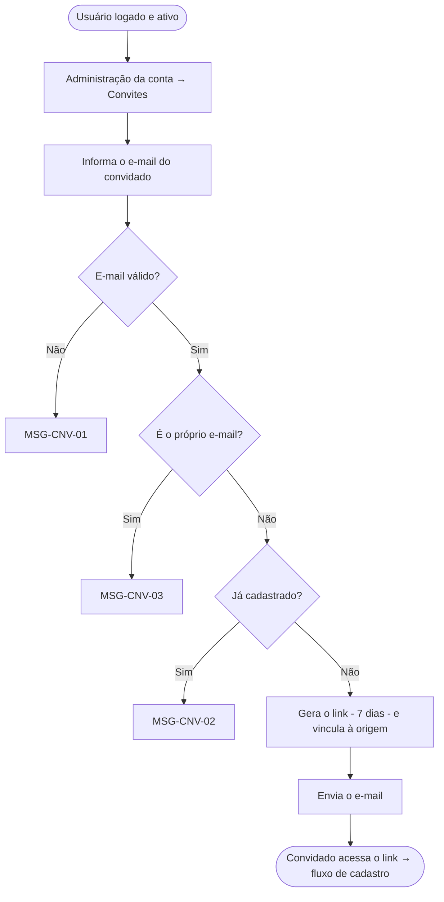

# Cabeçalho
| Campo | Valor |
|---|---|
| Documento | Fluxo — Envio de convite |
| Código | CNV |
| Status | Rascunho |
| Versão | 0.2 |
| Atualizado em | 2026-11-13 |
| Responsável | A definir |
| Relacionados | [negocio.md](../negocio.md), [fluxo-cadastro.md](fluxo-cadastro.md) |

# 1. Objetivo
Permitir que um usuário convide outra pessoa para se cadastrar na plataforma.

# 2. Atores
| Ator | Papel no fluxo |
|---|---|
| Usuário de origem | Envia o convite. |
| Convidado | Recebe o convite e se cadastra (ver [fluxo-cadastro.md](fluxo-cadastro.md), A4). |
| Sistema | Valida, gera o link e envia o convite. |

# 3. Pré-condições
- O usuário de origem está logado e com a conta **ativa**.

# 4. Gatilho
O usuário acessa a função de envio de convite dentro de **Administração da conta**.

# 5. Fluxo principal
| Passo | Quem | Ação |
|---|---|---|
| P1 | Usuário de origem | Acessa **Administração da conta** → **Convites**. |
| P2 | Sistema | Abre a tela de envio de convite. |
| P3 | Usuário de origem | Informa o **e-mail do convidado**. **[AJUSTE]** |
| P4 | Sistema | Valida o e-mail (formato, não é o próprio e-mail, não está cadastrado). |
| P5 | Sistema | Gera um link de convite com validade de 7 dias, vincula o convite ao usuário de origem e envia o e-mail ao convidado. |
| P6 | Sistema | Confirma o envio ao usuário de origem. |
| P7 | Convidado | Acessa o link e segue para o cadastro por convite ([fluxo-cadastro.md](fluxo-cadastro.md), A4). |

# 6. Fluxos alternativos
| ID | A partir de | Condição | O que acontece |
|---|---|---|---|
| A1 | P2 | **[SUGESTÃO]** O usuário quer ver os convites enviados. | O sistema lista os convites com o status (pendente, aceito, expirado, cancelado) e a data de envio. |
| A2 | A1 | **[SUGESTÃO]** O usuário reenvia um convite pendente ou expirado. | O sistema invalida o link anterior e volta ao P5 com um novo link. |
| A3 | A1 | **[SUGESTÃO]** O usuário cancela um convite pendente. | O link é invalidado e o convite fica com status **cancelado**. |

# 7. Fluxos de exceção
| ID | A partir de | Condição | O que acontece | Mensagem |
|---|---|---|---|---|
| E1 | P4 | E-mail em formato inválido. | O convite não é enviado. | MSG-CNV-01 |
| E2 | P4 | E-mail já cadastrado na plataforma. | O convite não é enviado. **[PENDENTE: PEND-CNV-02, PEND-CNV-05]** | MSG-CNV-02 |
| E3 | P4 | O e-mail é do próprio usuário de origem. | O convite não é enviado. | MSG-CNV-03 |
| E4 | P4 | **[SUGESTÃO]** Já existe um convite pendente do mesmo usuário para esse e-mail. | O sistema oferece o reenvio (A2). | MSG-CNV-04 |
| E5 | P4 | **[SUGESTÃO]** Limite diário de convites atingido. | O convite não é enviado. | MSG-CNV-05 |

**Exemplo de E3:** o usuário Jefferson, com o e-mail `jeff@hotmail.com`, tenta enviar um convite para `jeff@hotmail.com`.

# 8. Diagrama

# 9. Regras do fluxo
| ID | Regra |
|---|---|
| RF-CNV-01 | Só um usuário logado e com a conta ativa pode enviar convites. |
| RF-CNV-02 | O e-mail do convidado precisa ser válido. |
| RF-CNV-03 | O link do convite expira 7 dias após a data e a hora do envio. |
| RF-CNV-04 | O convite (indicação) fica vinculado ao usuário de origem. **[PENDENTE: PEND-CNV-04]** |
| RF-CNV-05 | Um usuário pode convidar N pessoas. |
| RF-CNV-06 | Não é possível convidar um e-mail já cadastrado. **[PENDENTE: PEND-CNV-02]** |
| RF-CNV-07 | Não é possível convidar o próprio e-mail. |
| RF-CNV-08 | **[SUGESTÃO]** O link do convite é de uso único: depois do cadastro, ele não pode ser usado de novo. |
| RF-CNV-09 | **[SUGESTÃO]** Existe um limite de convites por usuário por dia (ex.: 20), para evitar spam. |
| RF-CNV-10 | Todas as mensagens são curtas, claras e amigáveis. |

# 10. Mensagens ao usuário
| ID | Situação | Texto sugerido |
|---|---|---|
| MSG-CNV-01 | E-mail inválido | "Esse e-mail não parece válido. Confira e tente de novo." |
| MSG-CNV-02 | E-mail já cadastrado | "Essa pessoa já faz parte do Kasa!" |
| MSG-CNV-03 | Próprio e-mail | "Você não pode convidar a si mesmo. 😉" |
| MSG-CNV-04 | Convite já pendente | "Você já convidou essa pessoa. Quer reenviar o convite?" |
| MSG-CNV-05 | Limite diário | "Você atingiu o limite de convites de hoje. Tente amanhã." |
| MSG-CNV-06 | Convite enviado | "Convite enviado! Ele vale por 7 dias." |

# 11. Pós-condições
- Existe um convite com status **pendente**, vinculado ao usuário de origem, com validade de 7 dias.
- O convidado recebeu o e-mail com o link.

**[SUGESTÃO]** Estados do convite: `pendente` → `aceito` (cadastro concluído) / `expirado` (passou de 7 dias) / `cancelado` (pelo usuário de origem).

# 12. Pendências e pontos a especificar
| ID | Ponto | Por que importa | Sugestão |
|---|---|---|---|
| PEND-CNV-01 | O convite é só por e-mail ou também por celular? | Este documento prevê só e-mail, mas [fluxo-cadastro.md](fluxo-cadastro.md) fala em "e-mail ou celular". | Começar só com e-mail; celular numa fase posterior. |
| PEND-CNV-02 | **Conflito importante:** o proprietário precisa vincular como inquilino alguém que **já tem conta**, mas a regra RF-CNV-06 bloqueia o convite para e-mail já cadastrado. | Sem isso, não dá para vincular inquilinos, compradores ou corretores que já usam a plataforma. O `backend/backend.md` (item 3.7.4) já assume que o convite pode vincular um usuário existente. | Separar dois tipos: **indicação** (convite genérico para a plataforma, que bloqueia e-mail cadastrado) e **convite de vínculo** (com papel e imóvel; se o e-mail já tem conta, a pessoa recebe uma solicitação para aceitar o vínculo). |
| PEND-CNV-03 | O convite carrega um papel e um imóvel? (ex.: proprietário convida o inquilino do imóvel X, conforme RN-GER-10) | Define se o cadastro por convite já cria o vínculo. | Sim, no convite de vínculo (ver PEND-CNV-02). |
| PEND-CNV-04 | Para que serve o vínculo da indicação com o usuário de origem? Existe programa de indicação ou recompensa? | Define se é preciso relatório de indicações e regras de bonificação. | Guardar o vínculo para métricas; recompensas numa fase posterior. |
| PEND-CNV-05 | A mensagem "e-mail já cadastrado" revela a quem convida que a pessoa usa a plataforma. | Privacidade (LGPD). | Aceitável para a experiência, combinado com o limite diário (RF-CNV-09). |
| PEND-CNV-06 | Se o convidado se cadastrar sem usar o link, o convite pendente fica como? | Status e vínculo com a origem. | O convite passa para `aceito` se o e-mail coincidir, mantendo o vínculo com a origem. |

# 13. Histórico
| Data | Versão | Alteração | Autor |
|---|---|---|---|
| — | 0.1 | Criação | Autor original |
| 2026-11-13 | 0.2 | Padronização no modelo de fluxo; passos; exceções; diagrama; mensagens; estados; pendências. **[AJUSTE]** P3: o campo era "e-mail do usuário logado"; o correto é o e-mail do convidado. | Claude |
