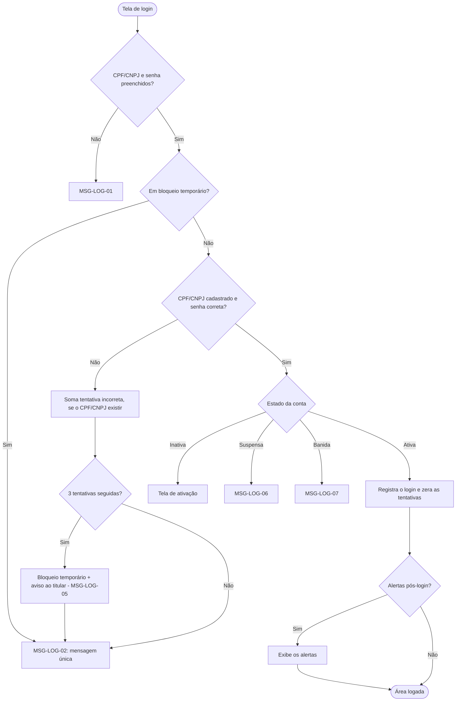

# Cabeçalho
| Campo | Valor |
|---|---|
| Documento | Fluxo — Login |
| Código | LOG |
| Status | Rascunho |
| Versão | 0.3 |
| Atualizado em | 2026-11-13 |
| Responsável | A definir |
| Relacionados | [tecnico-login.md](../tecnico/tecnico-login.md), [fluxo-ativacao-cadastro.md](fluxo-ativacao-cadastro.md), [fluxo-cadastro.md](fluxo-cadastro.md) |

# 1. Objetivo
Permitir que qualquer usuário, de qualquer perfil (pessoa física ou jurídica), entre na plataforma com CPF ou CNPJ e senha, sem revelar a terceiros quais CPFs/CNPJs estão cadastrados.

# 2. Atores
| Ator | Papel no fluxo |
|---|---|
| Usuário | Informa as credenciais. |
| Sistema | Autentica, verifica o estado da conta e exibe os alertas. |

# 3. Pré-condições
- Nenhuma. O próprio fluxo trata os casos de usuário sem cadastro, inativo ou bloqueado.

# 4. Gatilho
O usuário acessa a tela de login. O link "Sou novo por aqui" fica sempre visível nessa tela.

# 5. Fluxo principal
| Passo | Quem | Ação |
|---|---|---|
| P1 | Usuário | Informa o CPF ou CNPJ e a senha. |
| P2 | Sistema | Verifica se os dois campos foram preenchidos. |
| P3 | Sistema | Verifica se a conta está em bloqueio temporário. |
| P4 | Sistema | Verifica se o CPF/CNPJ tem cadastro **e** se a senha está correta. As duas falhas recebem a mesma resposta (RF-LOG-07). **[AJUSTE]** |
| P5 | Sistema | Com as credenciais corretas, verifica se a conta está ativa e sem bloqueio administrativo. |
| P6 | Sistema | Registra o login atual, guarda o anterior como "último login" e zera o contador de tentativas incorretas. |
| P7 | Sistema | Exibe os alertas pós-login, se houver (ver RF-LOG-03), e a data do último login. |
| P8 | Usuário | Acessa a área logada. |

# 6. Fluxos alternativos
| ID | A partir de | Condição | O que acontece |
|---|---|---|---|
| A1 | P1 | O usuário clica em "Esqueci minha senha". | Segue para o fluxo de recuperação de senha. **[PENDENTE: PEND-LOG-07]** |
| A2 | P7 | A flag de troca de senha está ativa. | O sistema avisa que a senha precisa ser trocada. **[PENDENTE: PEND-LOG-03]** |
| A3 | P1 | O usuário clica em "Sou novo por aqui". | Segue para o [cadastro](fluxo-cadastro.md). |

# 7. Fluxos de exceção
| ID | A partir de | Condição | O que acontece | Mensagem |
|---|---|---|---|---|
| E1 | P2 | CPF/CNPJ ou senha não informados. | O login não é feito. | MSG-LOG-01 |
| E2 | P4 | CPF/CNPJ sem cadastro **ou** senha incorreta. | O login não é feito. Se o CPF/CNPJ existir, o contador de tentativas incorretas aumenta. A resposta é a mesma nos dois casos, inclusive no tempo de resposta. **[AJUSTE]** | MSG-LOG-02 |
| ~~E3~~ | — | Unificado com o E2 (PEND-LOG-01). | — | — |
| E4 | P5 | Conta inativa. | O usuário é levado para a tela de [ativação](fluxo-ativacao-cadastro.md). | MSG-LOG-04 |
| E5 | P4 | Terceira tentativa incorreta seguida. | A conta fica bloqueada temporariamente. Na tela, a resposta continua sendo a mensagem única; o titular recebe um aviso pelo canal verificado. **[AJUSTE]** **[PENDENTE: PEND-LOG-02]** | MSG-LOG-02 (tela) e MSG-LOG-05 (aviso) |
| E5.1 | P3 | Nova tentativa durante o bloqueio temporário. | A senha **não** é verificada, e a resposta é a mensagem única. | MSG-LOG-02 |
| E6 | P5 | Existe um bloqueio administrativo com prazo (ex.: bloqueio por mau uso por X dias). | O login não é feito; o sistema informa até quando vale o bloqueio. | MSG-LOG-06 |
| E7 | P5 | O CPF/CNPJ foi banido permanentemente. | O login não é feito. | MSG-LOG-07 |

As exceções E4, E6 e E7 só aparecem **depois** que a senha foi confirmada (P5). Assim, só o próprio titular fica sabendo do estado da conta.

# 8. Diagrama

# 9. Regras do fluxo
| ID | Regra |
|---|---|
| RF-LOG-01 | **Regras bloqueantes.** Não é permitido logar se: a conta não estiver ativa; o CPF/CNPJ não tiver cadastro; a senha estiver incorreta; o CPF/CNPJ ou a senha não forem informados; houver bloqueio temporário, bloqueio administrativo vigente ou banimento. |
| RF-LOG-02 | Depois de 3 tentativas incorretas seguidas, a conta fica bloqueada temporariamente (ver [tecnico-login.md](../tecnico/tecnico-login.md)). |
| RF-LOG-03 | **Alertas pós-login.** Depois do login, o usuário é alertado se a flag de troca de senha estiver ativa ou se houver algum alerta para ele. |
| RF-LOG-04 | **[SUGESTÃO]** O contador de tentativas incorretas zera após um login bem-sucedido. |
| RF-LOG-05 | **[SUGESTÃO]** Depois do login, o sistema informa a data e a hora do último acesso. |
| RF-LOG-06 | **Regra de ouro:** todas as mensagens de alerta são curtas, claras e amigáveis. |
| RF-LOG-07 | **Mensagem única:** CPF/CNPJ sem cadastro, senha incorreta e conta em bloqueio temporário recebem a mesma mensagem (MSG-LOG-02), sem revelar qual foi o caso. |
| RF-LOG-08 | Durante o bloqueio temporário, as tentativas de login não verificam a senha. O titular é avisado do bloqueio pelo canal verificado (e-mail ou celular). |
| RF-LOG-09 | As mensagens que revelam o estado da conta (inativa, suspensa, banida) só aparecem depois que a senha foi confirmada. |

# 10. Mensagens ao usuário
| ID | Situação | Texto sugerido |
|---|---|---|
| MSG-LOG-01 | Campos vazios | "Informe seu CPF/CNPJ e sua senha para entrar." |
| MSG-LOG-02 | Sem cadastro, senha incorreta ou bloqueio temporário | "CPF/CNPJ ou senha incorretos. Confira os dados e tente de novo. Após várias tentativas, o acesso é bloqueado por alguns minutos." |
| ~~MSG-LOG-03~~ | Unificada com a MSG-LOG-02. | — |
| MSG-LOG-04 | Conta inativa | "Sua conta ainda não está ativa. Vamos ativar agora?" |
| MSG-LOG-05 | Aviso de bloqueio enviado ao titular (e-mail/SMS) | "Identificamos várias tentativas de acesso à sua conta Kasa. Por segurança, o acesso ficou bloqueado por {tempo}. Se não foi você, recomendamos trocar sua senha." |
| MSG-LOG-06 | Bloqueio administrativo | "Seu acesso está suspenso até {data e hora}. Em caso de dúvida, fale com o suporte." |
| MSG-LOG-07 | Banimento | "Este acesso não está disponível. Em caso de dúvida, fale com o suporte." |
| MSG-LOG-08 | Troca de senha pendente | "Por segurança, troque sua senha agora." |

# 11. Pós-condições
- O usuário está autenticado, com sessão ativa.
- A data do login atual foi registrada, e a anterior virou o "último login".
- O contador de tentativas incorretas foi zerado.

# 12. Pendências e pontos a especificar
| ID | Ponto | Por que importa | Sugestão |
|---|---|---|---|
| PEND-LOG-02 | Quanto tempo dura o bloqueio temporário? O bloqueio é por conta ou também por IP? | Bloquear só a conta permite que um atacante bloqueie a conta de outra pessoa de propósito. | 15 minutos por conta, mais limite de tentativas por IP. |
| PEND-LOG-03 | A flag de troca de senha **obriga** a troca antes de continuar ou é só um aviso? | Define se o usuário consegue usar o sistema sem trocar a senha. | Obrigar a troca antes de liberar a área logada. |
| PEND-LOG-04 | O texto original dizia para "alertar após o login" quando houvesse um alerta bloqueante, o que contradiz a ideia de bloqueio. | Hoje não fica claro se o usuário bloqueado entra ou não. | Bloqueio impede o login (E6); alerta não bloqueante aparece depois do login (RF-LOG-03). |
| PEND-LOG-05 | O administrador precisa de autenticação em dois fatores? | O `backend/backend.md` (item 3.6) já exige; falta a regra de negócio. | Obrigatória para administradores; opcional para os demais. |
| PEND-LOG-06 | Quanto tempo dura a sessão? Existe "lembrar de mim"? E o login em vários dispositivos? | Segurança e experiência. | Expirar após 30 minutos de inatividade, sem "lembrar de mim" no início, com vários dispositivos permitidos. |
| PEND-LOG-07 | O fluxo de **recuperação de senha** não existe. | É citado no login e no cadastro (MSG-CAD-02). | Criar `fluxo-recuperacao-senha.md`: código pelo canal verificado, validade curta e nova senha conforme a política. A resposta também deve ser única ("Se o CPF/CNPJ estiver cadastrado, enviaremos as instruções"). |

## Pendências resolvidas
| ID | Decisão | Data |
|---|---|---|
| PEND-LOG-01 | Priorizar a segurança: CPF/CNPJ sem cadastro e senha incorreta recebem a mesma mensagem (RF-LOG-07), o que vale também para o bloqueio temporário (RF-LOG-08). O estado da conta só é revelado depois da senha correta (RF-LOG-09). | 2026-11-13 |

# 13. Histórico
| Data | Versão | Alteração | Autor |
|---|---|---|---|
| — | 0.1 | Criação | Autor original |
| 2026-11-13 | 0.2 | Padronização no modelo de fluxo; passos; exceções; diagrama; mensagens; pendências. **[AJUSTE]** Login por "CPF" → "CPF ou CNPJ", alinhado a `tecnico-login.md`. **[AJUSTE]** O bloqueio administrativo passou a impedir o login (E6), em vez de ser só um alerta pós-login (ver PEND-LOG-04). **[AJUSTE]** Incluído o bloqueio após 3 tentativas, que estava só no documento técnico. | Claude |
| 2026-11-13 | 0.3 | Resolvida PEND-LOG-01. **[AJUSTE]** E2 e E3 unificados com a mensagem única MSG-LOG-02 (substitui o texto original "Ops… não foi possível localizar o seu CPF"). **[AJUSTE]** O bloqueio temporário não é mais revelado na tela: o titular é avisado pelo canal verificado. **[AJUSTE]** Os estados da conta só são verificados depois da senha correta. Novas regras RF-LOG-07 a RF-LOG-09. | Claude |
