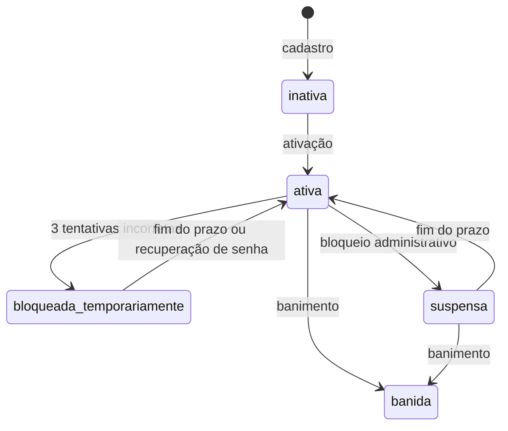

# Cabeçalho
| Campo | Valor |
|---|---|
| Documento | Técnico — Login e conta |
| Código | LOG |
| Status | Rascunho |
| Versão | 0.3 |
| Atualizado em | 2026-11-13 |
| Responsável | A definir |
| Relacionados | [fluxo-login.md](../fluxo/fluxo-login.md), [fluxo-ativacao-cadastro.md](../fluxo/fluxo-ativacao-cadastro.md), [tecnico-cadastro.md](tecnico-cadastro.md), [negocio.md](../negocio.md) |

# 1. Objetivo
Especificar os dados de credenciais, o estado da conta, os bloqueios, a política de senha e as regras técnicas do login.

# 2. Dados
Coluna **LGPD**: `Pessoal` = dado pessoal; `Sensível` = exige proteção reforçada; `—` = não pessoal.

## 2.1. Credenciais e estado da conta
| Campo | Tipo | Obrigatório | Formato / validação | LGPD | Observação |
|---|---|---|---|---|---|
| Login | Texto | Sim | O CPF (11 números) ou o CNPJ (14 caracteres alfanuméricos) do cadastro. | Sensível | Mesmo valor de [tecnico-cadastro.md](tecnico-cadastro.md) (RT-CAD-09). |
| Senha | Texto (hash) | Sim | Hash forte com salt (ex.: Argon2 ou bcrypt). | Sensível | Nunca em texto puro (`backend/backend.md` 3.2). |
| Status da conta | Lista | Sim | Ver a seção 3. | — | **[SUGESTÃO]** Substitui a flag "conta ativa" por um estado único. **[AJUSTE]** |
| Troca de senha obrigatória | Booleano | Sim | Padrão: falso. | — | Flag de recuperação de senha. **[PENDENTE: PEND-LOG-09]** |
| Tentativas incorretas | Número | Sim | Padrão: 0. | — | Zera após um login bem-sucedido. |
| Bloqueado até | Data e hora | Não | Preenchido no bloqueio temporário. | — | Bloqueio após 3 tentativas incorretas. |
| Login atual em | Data e hora | Não | UTC. | Pessoal | Data do login da sessão atual. |
| Último login em | Data e hora | Não | UTC. | Pessoal | Data do login anterior, exibida ao usuário. |
| Perfil | Lista | Sim | `padrao` ou `administrador`. | — | RN-CAD-09. |
| Papéis | Lista | Não | `proprietario`, `inquilino`, `corretor`, `comprador`. | — | Conforme [negocio.md](../negocio.md). **[SUGESTÃO]** Derivados dos vínculos com imóveis (RN-CAD-13). |

## 2.2. Bloqueios administrativos
Bloqueios aplicados pela administração, com histórico. Um usuário pode ter vários ao longo do tempo.

| Campo | Tipo | Obrigatório | Formato / validação | LGPD | Observação |
|---|---|---|---|---|---|
| Tipo | Lista | Sim | `temporario` ou `permanente` | — | Ex.: bloqueio por mau uso por X dias; banimento do CPF. |
| Motivo | Texto | Sim | máx. 500 | Pessoal | |
| Início em | Data e hora | Sim | UTC | — | |
| Fim em | Data e hora | Condicional | Obrigatório se `temporario`; vazio se `permanente`. | — | |
| Aplicado por | Referência | Sim | Administrador que aplicou o bloqueio. | — | Auditoria (RN-GER-22). |

## 2.3. Lista de documentos banidos — **[SUGESTÃO]**
| Campo | Tipo | Obrigatório | Formato / validação | LGPD | Observação |
|---|---|---|---|---|---|
| CPF/CNPJ | Texto (hash) | Sim | Hash do documento. | Sensível | Impede que um CPF banido faça um novo cadastro. |
| Banido em | Data e hora | Sim | UTC | — | |
| Bloqueio de origem | Referência | Sim | — | — | |

## 2.4. Histórico de acessos — **[SUGESTÃO]**
| Campo | Tipo | Obrigatório | Formato / validação | LGPD | Observação |
|---|---|---|---|---|---|
| Data e hora | Data e hora | Sim | UTC | — | |
| Resultado | Lista | Sim | `sucesso`, `senha_incorreta`, `inativa`, `bloqueada`, `banida` | — | |
| IP | Texto | Sim | IPv4 ou IPv6 | Pessoal | |
| Dispositivo | Texto | Não | Navegador e sistema | Pessoal | |

# 3. Estados da conta — **[SUGESTÃO]**
| Estado | Significado | Vai para |
|---|---|---|
| `inativa` | Cadastrada, ainda não ativada. | `ativa` |
| `ativa` | Pode logar. | `bloqueada_temporariamente`, `suspensa`, `banida` |
| `bloqueada_temporariamente` | 3 tentativas incorretas seguidas. | `ativa` (ao fim do prazo ou pela recuperação de senha) |
| `suspensa` | Bloqueio administrativo com prazo. | `ativa` (ao fim do prazo), `banida` |
| `banida` | Bloqueio administrativo permanente. | — |

# 4. Regras técnicas
| ID | Regra |
|---|---|
| RT-LOG-01 | O login é feito pela combinação de CPF ou CNPJ e senha. |
| RT-LOG-02 | A autenticação e a autorização usam OAuth 2.0 com OpenID Connect, por meio do provedor de identidade definido em `docs/stack.md`. **[AJUSTE]** |
| RT-LOG-03 | A sessão é entregue ao navegador em cookie `HttpOnly`, `Secure` e `SameSite` (`frontend/frontend.md` 4.1). |
| RT-LOG-04 | A cada login bem-sucedido, a data do login atual passa para "último login", e a nova data é gravada como "login atual". |
| RT-LOG-05 | Depois de 3 tentativas incorretas seguidas, a conta fica `bloqueada_temporariamente` até a data de "bloqueado até". Durante o bloqueio, a senha não é verificada, e o titular é avisado pelo canal verificado (RF-LOG-08). **[PENDENTE: PEND-LOG-02]** |
| RT-LOG-06 | O contador de tentativas incorretas zera após um login bem-sucedido. |
| RT-LOG-07 | Um bloqueio administrativo vigente (data atual entre o início e o fim, ou permanente) impede o login. |
| RT-LOG-08 | **[SUGESTÃO]** Um CPF/CNPJ banido não pode logar nem fazer um novo cadastro. |
| RT-LOG-09 | Todo usuário tem o perfil `padrao` ou `administrador`, e pode ter papéis conforme [negocio.md](../negocio.md). |
| RT-LOG-10 | **[SUGESTÃO]** O perfil `administrador` exige autenticação em dois fatores (PEND-LOG-05). |
| RT-LOG-11 | **[SUGESTÃO]** Toda tentativa de login é registrada no histórico de acessos (seção 2.4). |
| RT-LOG-12 | A resposta para CPF/CNPJ inexistente, senha incorreta e conta em bloqueio temporário é idêntica: mesma mensagem, mesmo código HTTP e tempo de resposta equivalente (a senha é comparada mesmo quando o CPF/CNPJ não existe, para não revelar a diferença pelo tempo). Ver RF-LOG-07. |
| RT-LOG-13 | O estado da conta (inativa, suspensa, banida) só é informado depois que a senha foi confirmada (RF-LOG-09). |

## 4.1. Política de senha — **[SUGESTÃO]** **[PENDENTE: PEND-LOG-11]**
| ID | Regra |
|---|---|
| RT-SEN-01 | Mínimo de 8 e máximo de 64 caracteres. |
| RT-SEN-02 | Pelo menos uma letra maiúscula, uma minúscula, um número e um caractere especial. |
| RT-SEN-03 | Não pode conter o CPF/CNPJ do usuário. Para PF, também não pode conter o nome nem a data de nascimento; para PJ, a razão social, o nome fantasia nem a data de abertura. |
| RT-SEN-04 | Não pode ser igual às 3 últimas senhas. |
| RT-SEN-05 | A confirmação precisa ser igual à senha. |

# 5. Validações
| Validação | Frontend | Backend |
|---|---|---|
| CPF/CNPJ e senha preenchidos | ✅ | ✅ |
| Política de senha (no cadastro e na troca) | ✅ (indicador visual) | ✅ |
| Credenciais corretas | — | ✅ |
| Estado da conta e bloqueios | — | ✅ |

# 6. Rotinas, integrações e eventos
| Item | Tipo | Descrição |
|---|---|---|
| Provedor de identidade | Integração | Autenticação OAuth 2.0 / OpenID Connect (`docs/stack.md`). |
| Fim de bloqueios | Rotina | Volta para `ativa` as contas cujo bloqueio temporário ou suspensão chegou ao fim (ou verificação no próprio login). |
| Conta bloqueada | Evento | **[SUGESTÃO]** Envia um aviso ao usuário pelo canal verificado. |

# 7. Segurança e LGPD
- A senha é gravada só como hash com salt e nunca aparece em logs.
- Limite de tentativas por IP, além do limite por conta (PEND-LOG-02).
- O histórico de acessos tem prazo de retenção definido (PEND-LOG-13).
- Os bloqueios e banimentos registram qual administrador os aplicou.

# 8. Pendências e pontos a especificar
| ID | Ponto | Por que importa | Sugestão |
|---|---|---|---|
| PEND-LOG-08 | O texto original citava uma "sessão de dados técnicos" que não existia. | Não fica claro se havia mais campos previstos. | Confirmar se a lista da seção 2 está completa. |
| PEND-LOG-09 | O que significa a "flag de recuperação de senha"? Indica que a recuperação está em andamento ou obriga a troca da senha no próximo login? | Define o comportamento do login (ver PEND-LOG-03). | Tratar como "troca de senha obrigatória", ligada pela recuperação ou pelo administrador. |
| PEND-LOG-10 | Os papéis são gravados no usuário ou calculados a partir dos vínculos com os imóveis? | Evita papéis desatualizados (ex.: inquilino cuja locação terminou). | Calcular a partir dos vínculos. |
| PEND-LOG-11 | Confirmar a política de senha sugerida (seção 4.1). | O cadastro já depende dela. | Regras RT-SEN-01 a RT-SEN-05. |
| PEND-LOG-12 | Quanto tempo dura a sessão e o que acontece com as sessões abertas quando a senha muda? | Segurança da conta. | Encerrar todas as sessões na troca de senha (ver PEND-LOG-06). |
| PEND-LOG-13 | Por quanto tempo o histórico de acessos é guardado? | LGPD e Marco Civil da Internet (guarda de registros de acesso). | 6 meses, prazo mínimo do Marco Civil para provedores de aplicação. |
| PEND-LOG-14 | Quem pode aplicar e remover bloqueios e banimentos? Existe pedido de revisão pelo usuário? | Direito de defesa e de contestação do usuário. | Apenas administradores, com motivo obrigatório e canal de contestação. |

# 9. Histórico
| Data | Versão | Alteração | Autor |
|---|---|---|---|
| — | 0.1 | Criação, como `informacoes-tecnicas-de-login.md` | Autor original |
| 2026-11-13 | 0.2 | Arquivo renomeado para `tecnico-login.md`. Padronização no modelo técnico; tabelas de campos; estados da conta; bloqueios; política de senha; pendências. **[AJUSTE]** RT-LOG-02: "OAuth 2.0" → "OAuth 2.0 com OpenID Connect", porque o OAuth 2.0 sozinho trata de autorização, e a autenticação vem do OpenID Connect. **[AJUSTE]** A flag "conta ativa" e a flag de bloqueio foram unificadas no "status da conta". | Claude |
| 2026-11-13 | 0.3 | Alinhado às decisões de PEND-LOG-01 (mensagem única) e PEND-CAD-14 (CNPJ alfanumérico): novas RT-LOG-12 e RT-LOG-13; RT-LOG-05 e RT-SEN-03 atualizadas para o bloqueio silencioso e para PF/PJ. | Claude |
