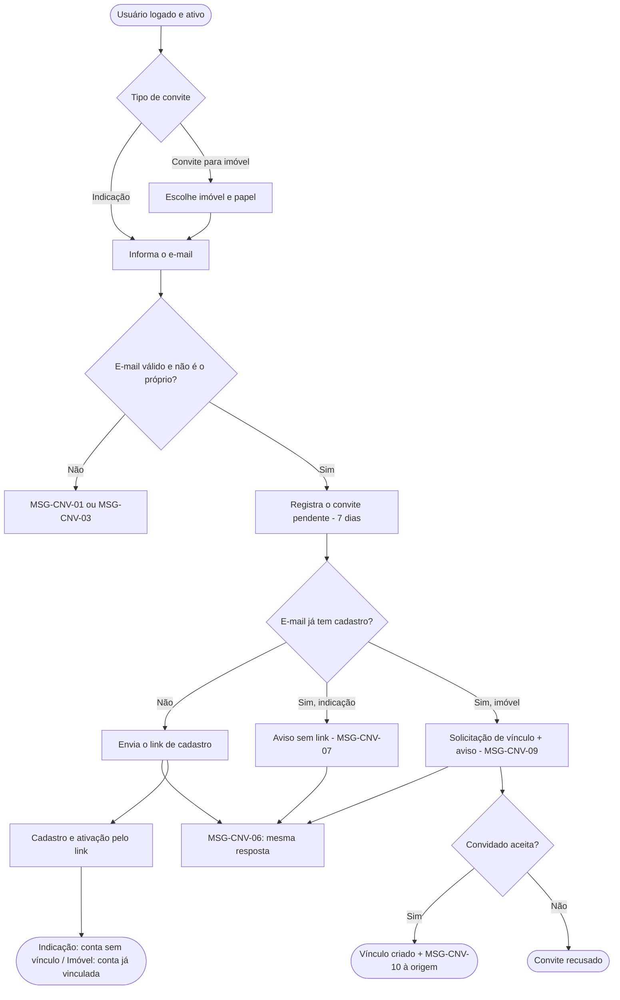

# Cabeçalho
| Campo | Valor |
|---|---|
| Documento | Fluxo — Convites (indicação e convite para imóvel) |
| Código | CNV |
| Status | Rascunho |
| Versão | 0.4 |
| Atualizado em | 2026-11-14 |
| Responsável | A definir |
| Relacionados | [negocio.md](../negocio.md), [fluxo-cadastro.md](fluxo-cadastro.md), [fluxo-ativacao-cadastro.md](fluxo-ativacao-cadastro.md) |

# 1. Objetivo
Permitir que um usuário convide outra pessoa de duas formas (RF-CNV-13):

| | **Indicação** | **Convite para imóvel** |
|---|---|---|
| Para que serve | Chamar alguém para conhecer o Kasa. | Ligar uma pessoa a um imóvel com um papel (ex.: inquilina do imóvel comercial da Rita). |
| O que leva junto | Só o e-mail. | O e-mail, o imóvel e o papel. |
| Se a pessoa **não** tem conta | Faz o cadastro pelo link e entra sem vínculo. | Faz o cadastro pelo link e já entra ligada ao imóvel. |
| Se a pessoa **já** tem conta | Recebe um aviso de que foi convidada (RF-CNV-12). | Recebe uma solicitação de vínculo, para aceitar ou recusar (RF-CNV-16). |
| O que quem convidou vê | Sempre "Convite enviado!" (RF-CNV-11). | Sempre "Convite enviado!" (RF-CNV-11). |

# 2. Atores
| Ator | Papel no fluxo |
|---|---|
| Usuário de origem | Envia o convite. |
| Convidado sem conta | Recebe o link e se cadastra (ver [fluxo-cadastro.md](fluxo-cadastro.md), A4). |
| Convidado com conta | Recebe o aviso (indicação) ou a solicitação de vínculo (convite para imóvel). |
| Sistema | Valida, registra, envia e cria o vínculo após o aceite. |

# 3. Pré-condições
- O usuário de origem está logado e com a conta **ativa**.
- **Convite para imóvel:** o usuário de origem tem permissão para conceder o papel naquele imóvel (RF-CNV-15).

# 4. Gatilho
- **Indicação:** **Administração da conta** → **Convites**.
- **Convite para imóvel:** **[SUGESTÃO]** opção "Convidar" na tela do imóvel, além de **Administração da conta** → **Convites**.

# 5. Fluxo principal
| Passo | Quem | Ação |
|---|---|---|
| P1 | Usuário de origem | Acessa a função de convite (ver gatilho). |
| P2 | Sistema | Abre a tela de convite e pergunta o tipo: **indicação** ou **convite para imóvel**. Mostra apenas os tipos que o usuário pode enviar (RF-CNV-15). **[AJUSTE]** |
| P2.1 | Usuário de origem | **Convite para imóvel:** escolhe o imóvel e o papel, entre os que pode conceder. |
| P3 | Usuário de origem | Informa o **e-mail do convidado**. |
| P4 | Sistema | Valida o e-mail: formato e se não é o próprio e-mail. **Não** informa se o e-mail tem cadastro (RF-CNV-11). |
| P5 | Sistema | Registra o convite com o tipo (e, se for o caso, o imóvel e o papel), status **pendente**, vinculado ao usuário de origem e válido por 7 dias. Em seguida, conforme o caso: |
| P5.1 | Sistema | E-mail **sem** cadastro: gera o link de cadastro e envia o e-mail ao convidado (MSG-CNV-08 no convite para imóvel). |
| P5.2 | Sistema | E-mail **com** cadastro, **indicação:** envia só o aviso, sem link de cadastro (RF-CNV-12, MSG-CNV-07). |
| P5.3 | Sistema | E-mail **com** cadastro, **convite para imóvel:** cria a solicitação de vínculo na área logada do convidado e avisa por e-mail (RF-CNV-16, MSG-CNV-09). |
| P6 | Sistema | Confirma ao usuário de origem com a MSG-CNV-06, **em qualquer caso** (RF-CNV-11). |
| P7 | Convidado sem conta | Acessa o link e segue para o cadastro por convite ([fluxo-cadastro.md](fluxo-cadastro.md), A4). No convite para imóvel, o vínculo é criado quando a ativação é concluída (RF-CNV-14). |
| P8 | Convidado com conta | **Convite para imóvel:** entra no Kasa e aceita (A4) ou recusa (A5) a solicitação. |

# 6. Fluxos alternativos
| ID | A partir de | Condição | O que acontece |
|---|---|---|---|
| A1 | P2 | **[SUGESTÃO]** O usuário quer ver os convites enviados. | O sistema lista os convites com o tipo, o imóvel e o papel (se houver), o status e a data de envio. O status segue a RF-CNV-17. |
| A2 | A1 | **[SUGESTÃO]** O usuário reenvia um convite pendente ou expirado. | O sistema invalida o anterior e volta ao P5. |
| A3 | A1 | **[SUGESTÃO]** O usuário cancela um convite pendente. | O link ou a solicitação é invalidado, e o convite fica com status **cancelado**. |
| A4 | P8 | O convidado com conta **aceita** a solicitação. | O vínculo com o imóvel e o papel é criado, o convite fica **aceito** e o usuário de origem é avisado (MSG-CNV-10). |
| A5 | P8 | O convidado **recusa** a solicitação. | Nenhum vínculo é criado, e o convite fica **recusado**. **[PENDENTE: PEND-CNV-09]** |

# 7. Fluxos de exceção
| ID | A partir de | Condição | O que acontece | Mensagem |
|---|---|---|---|---|
| E1 | P4 | E-mail em formato inválido. | O convite não é enviado. | MSG-CNV-01 |
| ~~E2~~ | — | Removido: o e-mail já cadastrado recebe a mesma resposta de um convite novo (RF-CNV-11, PEND-CNV-05). | — | — |
| E3 | P4 | O e-mail é do próprio usuário de origem. | O convite não é enviado. | MSG-CNV-03 |
| E4 | P4 | **[SUGESTÃO]** Já existe um convite pendente do mesmo usuário para esse e-mail (na indicação) ou para o mesmo e-mail, imóvel e papel (no convite para imóvel). | O sistema oferece o reenvio (A2). | MSG-CNV-04 |
| E5 | P4 | **[SUGESTÃO]** Limite diário de convites atingido. | O convite não é enviado. | MSG-CNV-05 |
| E6 | P7, P8 | O convite passou de 7 dias sem aceite. | O link ou a solicitação deixa de valer, e o convite fica **expirado**. | MSG-CAD-05 (no link) |
| E7 | P7, P8 | **[SUGESTÃO]** Antes do aceite, o usuário de origem perde o acesso ao imóvel (compartilhamento revogado, imóvel removido). | O convite é cancelado automaticamente (RF-CNV-18). | — |
| E8 | P2.1 | O imóvel já tem um inquilino, ou o papel exige um requisito que o convidado pode não ter (ex.: CRECI para corretor). | **[PENDENTE: PEND-CNV-11]** | — |

**Exemplo de E3:** o usuário Jefferson, com o e-mail `jeff@hotmail.com`, tenta enviar um convite para `jeff@hotmail.com`.

# 8. Diagrama

# 9. Regras do fluxo
| ID | Regra |
|---|---|
| RF-CNV-01 | Só um usuário logado e com a conta ativa pode enviar convites. |
| RF-CNV-02 | O e-mail do convidado precisa ser válido. |
| RF-CNV-03 | O convite expira 7 dias após a data e a hora do envio, nos dois tipos. |
| RF-CNV-04 | O convite fica vinculado ao usuário de origem. **[PENDENTE: PEND-CNV-04]** |
| RF-CNV-05 | Um usuário pode convidar N pessoas, respeitado o limite diário (RF-CNV-09). |
| ~~RF-CNV-06~~ | Removida: bloquear o e-mail já cadastrado revelava quem tem conta (DIR-01). Substituída pela RF-CNV-11. |
| RF-CNV-07 | Não é possível convidar o próprio e-mail. |
| RF-CNV-08 | **[SUGESTÃO]** O link do convite é de uso único: depois do cadastro, ele não pode ser usado de novo. |
| RF-CNV-09 | **[SUGESTÃO]** Existe um limite de convites por usuário por dia (ex.: 20), somando os dois tipos, para evitar spam. |
| RF-CNV-10 | Todas as mensagens são curtas, claras e amigáveis. |
| RF-CNV-11 | **Resposta neutra:** quem convida nunca fica sabendo se o e-mail tem cadastro. A resposta é sempre a MSG-CNV-06, nos dois tipos, e o convite aparece na lista (A1) como qualquer outro. Nenhuma conta é duplicada (DIR-01). |
| RF-CNV-12 | **Indicação** para e-mail que já tem conta: o titular recebe por e-mail um aviso de que foi convidado, **sem link de cadastro**, apenas com o caminho para entrar (MSG-CNV-07). O aviso conta no limite diário de quem convidou (RF-CNV-09). **[AJUSTE]** |
| RF-CNV-13 | Existem dois tipos de convite: **indicação** (só o e-mail, sem vínculo) e **convite para imóvel** (e-mail, imóvel e papel). |
| RF-CNV-14 | No convite para imóvel enviado a quem não tem conta, o vínculo com o imóvel e o papel é criado automaticamente quando o convidado conclui o cadastro pelo link e a ativação. |
| RF-CNV-15 | **[SUGESTÃO]** Quem pode enviar cada tipo: **[PENDENTE: PEND-CNV-08]** • **Proprietário:** indicação; convite para imóvel como inquilino, comprador ou corretor, nos imóveis próprios. • **Corretor com escopo de gestão:** indicação; convite para imóvel como inquilino ou comprador, nos imóveis que gerencia; convite a proprietários (RN-GER-13). • **Inquilino e comprador:** só indicação. |
| RF-CNV-16 | No convite para imóvel enviado a quem **já tem conta**, o vínculo **só** é criado depois que o convidado aceita a solicitação na área logada. O convidado recebe o aviso por e-mail (MSG-CNV-09). Nenhum vínculo é criado sem o aceite. |
| RF-CNV-17 | Status do convite: `pendente`, `aceito`, `recusado` **[PENDENTE: PEND-CNV-09]**, `expirado` e `cancelado`. Enquanto o convidado não responde, a lista mostra `pendente` em qualquer caso, para não revelar se ele tem conta. O aviso de aceite (MSG-CNV-10) pode identificar o convidado, porque o aceite é um consentimento dele. |
| RF-CNV-18 | **[SUGESTÃO]** Se o usuário de origem perder o acesso ao imóvel antes do aceite, os convites pendentes para aquele imóvel são cancelados. |

# 10. Mensagens ao usuário
| ID | Situação | Texto sugerido |
|---|---|---|
| MSG-CNV-01 | E-mail inválido | "Esse e-mail não parece válido. Confira e tente de novo." |
| ~~MSG-CNV-02~~ | Removida: revelava que o e-mail tinha cadastro (PEND-CNV-05). | — |
| MSG-CNV-03 | Próprio e-mail | "Você não pode convidar a si mesmo. 😉" |
| MSG-CNV-04 | Convite já pendente | "Você já convidou essa pessoa. Quer reenviar o convite?" |
| MSG-CNV-05 | Limite diário | "Você atingiu o limite de convites de hoje. Tente amanhã." |
| MSG-CNV-06 | Convite enviado (qualquer tipo, e-mail novo ou já cadastrado) | "Convite enviado! Ele vale por 7 dias." |
| MSG-CNV-07 | Indicação para quem já tem conta (e-mail) | "{Nome de quem convidou} convidou você para o Kasa. Você já tem conta: é só entrar." |
| MSG-CNV-08 | Convite para imóvel, para quem não tem conta (e-mail) | "{Nome de quem convidou} convidou você para ser {papel} de um imóvel no Kasa. Crie sua conta por este link, válido por 7 dias." **[PENDENTE: PEND-CNV-10]** |
| MSG-CNV-09 | Convite para imóvel, para quem já tem conta (e-mail) | "{Nome de quem convidou} quer vincular você como {papel} de um imóvel no Kasa. Entre na sua conta para aceitar ou recusar." **[PENDENTE: PEND-CNV-10]** |
| MSG-CNV-10 | Aceite, para quem convidou | "{Nome do convidado} aceitou o convite para ser {papel} do imóvel {identificação}." |

# 11. Pós-condições
- Existe um convite com status **pendente**, do tipo escolhido, vinculado ao usuário de origem, com validade de 7 dias.
- Quem convidou recebeu a mesma confirmação em todos os casos.
- O convidado recebeu: o link de cadastro (sem conta), o aviso (indicação, com conta) ou a solicitação de vínculo (convite para imóvel, com conta).
- No convite para imóvel, o vínculo só existe depois da ativação (sem conta) ou do aceite (com conta).

**[SUGESTÃO]** Estados do convite: `pendente` → `aceito` (cadastro pelo link ou aceite da solicitação) / `recusado` (convidado recusou) / `expirado` (passou de 7 dias) / `cancelado` (pelo usuário de origem ou pela RF-CNV-18).

# 12. Pendências e pontos a especificar
| ID | Ponto | Por que importa | Sugestão |
|---|---|---|---|
| PEND-CNV-01 | O convite é só por e-mail ou também por celular? | Este documento prevê só e-mail, mas [fluxo-cadastro.md](fluxo-cadastro.md) fala em "e-mail ou celular". | Começar só com e-mail; celular numa fase posterior. |
| PEND-CNV-04 | Para que serve o vínculo do convite com o usuário de origem? Existe programa de indicação ou recompensa? | Define se é preciso relatório de indicações e regras de bonificação. | Guardar o vínculo para métricas; recompensas numa fase posterior. |
| PEND-CNV-06 | Se o convidado se cadastrar sem usar o link, o convite pendente fica como? | Status e vínculo com a origem. | **[AJUSTE]** Só passa para `aceito` quando o cadastro é feito pelo link. Marcar como `aceito` por coincidência de e-mail revelaria, na lista de convites, que a pessoa tem conta (DIR-01). No convite para imóvel, a solicitação continua valendo para a nova conta até expirar. |
| PEND-CNV-08 | Quem pode enviar cada tipo de convite, e para quais papéis? | Define as permissões da tela de convite e do backend. | Regra RF-CNV-15. |
| PEND-CNV-09 | O status `recusado` aparece para quem convidou? | Só quem tem conta consegue recusar pela área logada. Se `recusado` aparecer, revela que a pessoa tem conta (DIR-01). | Permitir recusar também pelo link do e-mail (sem conta), para que `recusado` não diferencie os casos. Alternativa: mostrar `recusado` como `expirado`. |
| PEND-CNV-10 | Quais dados do imóvel aparecem no e-mail do convite? | O e-mail pode cair na mão errada (e-mail digitado errado); o endereço completo de um imóvel é dado sensível para o proprietário. | No e-mail, só o papel e o nome de quem convidou. Os dados do imóvel aparecem só depois do login. |
| PEND-CNV-11 | O que acontece se o imóvel já tem inquilino, ou se o papel exige um requisito (ex.: CRECI do corretor, PEND-CAD-03)? | Evita dois inquilinos ativos no mesmo imóvel e corretores sem registro. | Depende dos documentos de locação e de compartilhamento com corretor, ainda faltantes. Até lá, permitir um único convite para imóvel pendente ou aceito por papel de inquilino. |

## Pendências resolvidas
| ID | Decisão | Data |
|---|---|---|
| PEND-CNV-02 | Os convites são separados em dois tipos: **indicação** e **convite para imóvel** (RF-CNV-13). Quem já tem conta recebe uma solicitação de vínculo (RF-CNV-16). | 2026-11-14 |
| PEND-CNV-03 | O convite para imóvel carrega o imóvel e o papel, e o vínculo é criado após a ativação (sem conta) ou o aceite (com conta) (RF-CNV-14, RF-CNV-16). A indicação não carrega vínculo. | 2026-11-14 |
| PEND-CNV-05 | Priorizar a segurança: o convite para e-mail já cadastrado recebe a mesma resposta de um convite novo (MSG-CNV-06). Quem convida nunca fica sabendo se a pessoa tem conta (RF-CNV-11). | 2026-11-14 |
| PEND-CNV-07 | Na indicação, quem já tem conta recebe um aviso de que foi convidado, sem link de cadastro (RF-CNV-12, MSG-CNV-07). | 2026-11-14 |

# 13. Histórico
| Data | Versão | Alteração | Autor |
|---|---|---|---|
| — | 0.1 | Criação | Autor original |
| 2026-11-13 | 0.2 | Padronização no modelo de fluxo; passos; exceções; diagrama; mensagens; estados; pendências. **[AJUSTE]** P3: o campo era "e-mail do usuário logado"; o correto é o e-mail do convidado. | Claude |
| 2026-11-14 | 0.3 | Resolvida PEND-CNV-05 (achado crítico 1 da auditoria de 2026-11-14). **[AJUSTE]** P4, P5 e P6: resposta neutra para e-mail já cadastrado. E2, RF-CNV-06 e MSG-CNV-02 removidos. Nova RF-CNV-11. Sugestão da PEND-CNV-06 ajustada à DIR-01. PEND-CNV-07 criada e resolvida: aviso sem link de cadastro (RF-CNV-12, MSG-CNV-07). | Claude |
| 2026-11-14 | 0.4 | Resolvidas PEND-CNV-02 e PEND-CNV-03: convites separados em **indicação** e **convite para imóvel**. Documento reestruturado: objetivo com tabela comparativa, P2.1, P5.1 a P5.3, P8, A4, A5, E6 a E8, RF-CNV-13 a RF-CNV-18, MSG-CNV-08 a MSG-CNV-10, estado `recusado`, diagrama. **[AJUSTE]** RF-CNV-12 passa a valer só para a indicação. Novas PEND-CNV-08 a PEND-CNV-11. | Claude |
