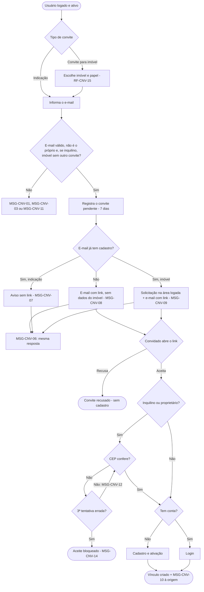

# Cabeçalho
| Campo | Valor |
|---|---|
| Documento | Fluxo — Convites (indicação e convite para imóvel) |
| Código | CNV |
| Status | Rascunho |
| Versão | 0.5 |
| Atualizado em | 2026-11-16 |
| Responsável | A definir |
| Relacionados | [negocio.md](../negocio.md), [fluxo-cadastro.md](fluxo-cadastro.md), [fluxo-ativacao-cadastro.md](fluxo-ativacao-cadastro.md) |

# 1. Objetivo
Permitir que um usuário convide outra pessoa de duas formas (RF-CNV-13):

| | **Indicação** | **Convite para imóvel** |
|---|---|---|
| Para que serve | Chamar alguém para conhecer o Kasa. | Ligar uma pessoa a um imóvel com um papel (ex.: inquilina do imóvel comercial da Rita). |
| Quem envia | Proprietário, corretor e inquilino (RF-CNV-15). | Proprietário e corretor, nos imóveis pelos quais respondem (RF-CNV-15). |
| O que leva junto | Só o e-mail, sem papel. | O e-mail, o papel e o código de vínculo do imóvel, protegidos no link (RF-CNV-23). O e-mail **não** traz dados do imóvel (RF-CNV-20). |
| Se a pessoa **não** tem conta | Faz o cadastro pelo link e entra sem vínculo. | Aceita pelo link, confirma o imóvel (se for inquilino ou proprietário), faz o cadastro e já entra ligada ao imóvel. |
| Se a pessoa **já** tem conta | Recebe um aviso de que foi convidada (RF-CNV-12). | Recebe a solicitação de vínculo (link no e-mail e área logada), entra, confirma o imóvel e aceita (RF-CNV-16). |
| Recusar | Pelo link, sem cadastro (RF-CNV-19). | Pelo link, sem cadastro e sem informar o CEP, ou pela área logada (RF-CNV-19). |
| Canal | Só e-mail (RF-CNV-25). | Só e-mail (RF-CNV-25). |
| O que quem convidou vê | Sempre "Convite enviado!" (RF-CNV-11). | Sempre "Convite enviado!" (RF-CNV-11). |

# 2. Atores
| Ator | Papel no fluxo |
|---|---|
| Usuário de origem | Envia o convite: proprietário, corretor ou inquilino, conforme RF-CNV-15. |
| Convidado sem conta | Abre o link, aceita ou recusa e, se aceitar, se cadastra (ver [fluxo-cadastro.md](fluxo-cadastro.md), A4). |
| Convidado com conta | Recebe o aviso (indicação) ou a solicitação de vínculo (convite para imóvel). |
| Sistema | Valida, registra, envia, confere a confirmação do imóvel e cria o vínculo após o aceite. |

# 3. Pré-condições
- O usuário de origem está logado e com a conta **ativa**.
- **Convite para imóvel:** o usuário de origem responde pelo imóvel e pode conceder o papel escolhido (RF-CNV-15).

# 4. Gatilho
- **Indicação:** **Administração da conta** → **Convites**.
- **Convite para imóvel:** **[SUGESTÃO]** opção "Convidar" na tela do imóvel, além de **Administração da conta** → **Convites**.

# 5. Fluxo principal
| Passo | Quem | Ação |
|---|---|---|
| P1 | Usuário de origem | Acessa a função de convite (ver gatilho). |
| P2 | Sistema | Abre a tela de convite e pergunta o tipo: **indicação** ou **convite para imóvel**. Mostra apenas os tipos que o usuário pode enviar (RF-CNV-15). |
| P2.1 | Usuário de origem | **Convite para imóvel:** escolhe o imóvel e o papel, entre os que pode conceder (RF-CNV-15). |
| P3 | Usuário de origem | Informa o **e-mail do convidado**. |
| P4 | Sistema | Valida o e-mail (formato e se não é o próprio e-mail) e, no convite de inquilino, se o imóvel não tem outro convite de inquilino pendente ou aceito (RF-CNV-22). **Não** informa se o e-mail tem cadastro (RF-CNV-11). |
| P5 | Sistema | Registra o convite com o tipo (e, se for o caso, o imóvel e o papel), status **pendente**, vinculado ao usuário de origem e válido por 7 dias. Em seguida, conforme o caso: |
| P5.1 | Sistema | E-mail **sem** cadastro: envia o convite com o link (MSG-CNV-08), sem dados do imóvel (RF-CNV-20). |
| P5.2 | Sistema | E-mail **com** cadastro, **indicação:** envia só o aviso, sem link de cadastro (RF-CNV-12, MSG-CNV-07). |
| P5.3 | Sistema | E-mail **com** cadastro, **convite para imóvel:** cria a solicitação de vínculo na área logada e envia o e-mail com o link (MSG-CNV-09), sem dados do imóvel (RF-CNV-16, RF-CNV-20). |
| P6 | Sistema | Confirma ao usuário de origem com a MSG-CNV-06, **em qualquer caso** (RF-CNV-11). |
| P7 | Convidado | Abre o link e escolhe **aceitar** ou **recusar** (A5). |
| P7.1 | Convidado | Ao aceitar um convite para ser **inquilino** ou **proprietário**, informa o CEP do imóvel, com no máximo 3 tentativas. O sistema localiza o imóvel pelo código de vínculo do convite e confere o CEP (RF-CNV-21). Só depois disso o convidado vê os dados do imóvel. Para recusar, o CEP não é pedido. |
| P7.2 | Convidado sem conta | Segue para o cadastro por convite ([fluxo-cadastro.md](fluxo-cadastro.md), A4). No convite para imóvel, o vínculo é criado quando a ativação é concluída (RF-CNV-14). |
| P8 | Convidado com conta | **Convite para imóvel:** entra no Kasa (pelo link ou pela área logada), confirma o CEP quando exigido (P7.1) e aceita. O vínculo é criado (A4). |

# 6. Fluxos alternativos
| ID | A partir de | Condição | O que acontece |
|---|---|---|---|
| A1 | P2 | **[SUGESTÃO]** O usuário quer ver os convites enviados. | O sistema lista os convites com o tipo, o imóvel e o papel (se houver), o status e a data de envio. O status segue a RF-CNV-17. |
| A2 | A1 | **[SUGESTÃO]** O usuário reenvia um convite pendente ou expirado. | O sistema invalida o anterior e volta ao P5. |
| A3 | A1 | **[SUGESTÃO]** O usuário cancela um convite pendente. | O link e a solicitação são invalidados, e o convite fica com status **cancelado**. |
| A4 | P8 | O convidado com conta **aceita** a solicitação. | O vínculo com o imóvel e o papel é criado, o convite fica **aceito** e o usuário de origem é avisado (MSG-CNV-10). |
| A5 | P7, P8 | O convidado **recusa** o convite, pelo link (com ou sem cadastro) ou pela área logada. | Nenhum vínculo é criado, o convite fica **recusado** e o link deixa de valer (RF-CNV-19). | 

# 7. Fluxos de exceção
| ID | A partir de | Condição | O que acontece | Mensagem |
|---|---|---|---|---|
| E1 | P4 | E-mail em formato inválido. | O convite não é enviado. | MSG-CNV-01 |
| ~~E2~~ | — | Removido: o e-mail já cadastrado recebe a mesma resposta de um convite novo (RF-CNV-11, PEND-CNV-05). | — | — |
| E3 | P4 | O e-mail é do próprio usuário de origem. | O convite não é enviado. | MSG-CNV-03 |
| E4 | P4 | **[SUGESTÃO]** Já existe um convite pendente do mesmo usuário para esse e-mail (na indicação) ou para o mesmo e-mail, imóvel e papel (no convite para imóvel). | O sistema oferece o reenvio (A2). | MSG-CNV-04 |
| E5 | P4 | **[SUGESTÃO]** Limite diário de convites atingido. | O convite não é enviado. | MSG-CNV-05 |
| E6 | P7, P8 | O convite passou de 7 dias sem resposta, inclusive quando o convidado se cadastrou sem usar o link (RF-CNV-24). | O link e a solicitação deixam de valer, e o convite fica **expirado**. | MSG-CAD-05 (no link) |
| E7 | P7, P8 | **[SUGESTÃO]** Antes do aceite, o usuário de origem deixa de responder pelo imóvel (compartilhamento revogado, imóvel removido). | O convite é cancelado automaticamente (RF-CNV-18). | MSG-CAD-05 (no link) |
| E8 | P4 | Convite de inquilino para um imóvel que já tem um convite de inquilino pendente ou aceito. | O convite não é enviado. A mensagem fala só do imóvel, sem nada sobre o convidado. | MSG-CNV-11 |
| E9 | P7.1 | O CEP informado não confere com o do imóvel. | O aceite não continua, e nenhum dado do imóvel é exibido. O convidado pode tentar de novo, até 3 vezes (RF-CNV-21). A recusa continua possível. | MSG-CNV-12 |
| E10 | P7.1 | Terceira tentativa de CEP errada. | O aceite fica bloqueado para esse convite. **[SUGESTÃO]** O convite é cancelado e quem convidou é avisado de que precisa refazê-lo. | MSG-CNV-14 |

**Exemplo de E3:** o usuário Jefferson, com o e-mail `jeff@hotmail.com`, tenta enviar um convite para `jeff@hotmail.com`.

**Exemplo de P7.1 e E9:** o Manoel convida a Padaria Pão Quente para ser inquilina do imóvel comercial da Rita, mas digita o e-mail errado. Quem recebe o e-mail vê só "Manoel convidou você para o Kasa como inquilino". Para aceitar, precisa informar o CEP do imóvel; sem saber o CEP, não vê o endereço nem passa adiante.

# 8. Diagrama

Na indicação sem conta, o fluxo segue do link direto para o cadastro, sem confirmação de CEP e sem vínculo.

# 9. Regras do fluxo
| ID | Regra |
|---|---|
| RF-CNV-01 | Só um usuário logado e com a conta ativa pode enviar convites. |
| RF-CNV-02 | O e-mail do convidado precisa ser válido. |
| RF-CNV-03 | O convite expira 7 dias após a data e a hora do envio, nos dois tipos. |
| RF-CNV-04 | O convite fica vinculado ao usuário de origem. A **indicação** serve só para trazer a pessoa para a plataforma (engajamento inicial). Não existe recompensa nem programa de indicação. **[AJUSTE]** |
| RF-CNV-05 | Um usuário pode convidar N pessoas, respeitado o limite diário (RF-CNV-09). |
| ~~RF-CNV-06~~ | Removida: bloquear o e-mail já cadastrado revelava quem tem conta (DIR-01). Substituída pela RF-CNV-11. |
| RF-CNV-07 | Não é possível convidar o próprio e-mail. |
| RF-CNV-08 | **[SUGESTÃO]** O link do convite é de uso único: depois do aceite ou da recusa, ele não pode ser usado de novo. |
| RF-CNV-09 | **[SUGESTÃO]** Existe um limite de convites por usuário por dia (ex.: 20), somando os dois tipos, para evitar spam. |
| RF-CNV-10 | Todas as mensagens são curtas, claras e amigáveis. |
| RF-CNV-11 | **Resposta neutra:** quem convida nunca fica sabendo se o e-mail tem cadastro. A resposta é sempre a MSG-CNV-06, nos dois tipos, e o convite aparece na lista (A1) como qualquer outro. Nenhuma conta é duplicada (DIR-01). |
| RF-CNV-12 | **Indicação** para e-mail que já tem conta: o titular recebe por e-mail um aviso de que foi convidado, **sem link de cadastro**, apenas com o caminho para entrar (MSG-CNV-07). O aviso conta no limite diário de quem convidou (RF-CNV-09). |
| RF-CNV-13 | Existem dois tipos de convite, com o mesmo envio e parâmetros diferentes: **indicação** (só o e-mail, **sem papel** e sem vínculo) e **convite para imóvel** (e-mail, **papel** e **código de vínculo do imóvel**, RF-CNV-23). **[AJUSTE]** |
| RF-CNV-14 | No convite para imóvel enviado a quem não tem conta, o vínculo com o imóvel e o papel é criado automaticamente quando o convidado aceita, confirma o imóvel (RF-CNV-21), conclui o cadastro pelo link e ativa a conta. |
| RF-CNV-15 | **Quem pode enviar cada convite:** **[AJUSTE]** • **Proprietário:** indicação; convite para imóvel como **corretor** (gestor) ou **inquilino**, nos seus imóveis. • **Corretor:** indicação; convite para imóvel como **proprietário** ou **inquilino**, nos imóveis pelos quais responde. **[PENDENTE: PEND-CNV-14]** • **Inquilino:** só indicação. • **Administrador:** qualquer convite, pela permissão total (RN-GER-21). Em todos os casos, o convidado pode ter cadastro ou não. **[PENDENTE: PEND-CNV-13]** (comprador). |
| RF-CNV-16 | No convite para imóvel enviado a quem **já tem conta**, o vínculo **só** é criado depois que o convidado entra, confirma o imóvel quando exigido (RF-CNV-21) e aceita. A solicitação aparece na área logada, e o e-mail traz o link (MSG-CNV-09). Nenhum vínculo é criado sem o aceite. **[AJUSTE]** |
| RF-CNV-17 | Status do convite: `pendente`, `aceito`, `recusado`, `expirado` e `cancelado`. Como qualquer convidado pode recusar, com ou sem conta (RF-CNV-19), nenhum status revela se a pessoa tem cadastro. O aviso de aceite (MSG-CNV-10) pode identificar o convidado, porque o aceite é um consentimento dele. **[AJUSTE]** |
| RF-CNV-18 | **[SUGESTÃO]** Se o usuário de origem deixar de responder pelo imóvel antes do aceite, os convites pendentes para aquele imóvel são cancelados. |
| RF-CNV-19 | Ao abrir o link, o convidado pode **aceitar** (e se cadastrar, se não tiver conta) ou **recusar**, mesmo **sem cadastro e sem login**. A recusa invalida o link. |
| RF-CNV-20 | O e-mail do convite **não** traz dados sensíveis nem dados do imóvel (endereço, CEP, valores). É só o convite: nome de quem convidou, papel e link. |
| RF-CNV-21 | Ao aceitar um convite para ser **inquilino** ou **proprietário**, o convidado informa o **CEP** do imóvel. O sistema localiza o imóvel pelo código de vínculo e só aceita se o CEP conferir. São no máximo **3 tentativas**; depois, o aceite fica bloqueado para esse convite (E10). Para **recusar**, o CEP não é pedido. Os dados do imóvel só aparecem depois da confirmação. Protege contra e-mail digitado errado. **[AJUSTE]** |
| RF-CNV-22 | Um imóvel só pode ter **um convite de inquilino pendente ou aceito por vez**. Regra provisória, até existirem os documentos de locação. |
| RF-CNV-23 | O link do convite para imóvel leva o **papel** e o **código de vínculo do imóvel** **protegidos (criptografados)**: ninguém consegue lê-los nem alterá-los pelo link. A indicação não leva papel. **[SUGESTÃO]** Em vez de dados criptografados, o link leva só um token aleatório (ver `backend/backend.md`, 3.7.1); o papel e o imóvel ficam guardados no servidor, ligados ao token. |
| RF-CNV-24 | Se o convidado se cadastrar **sem usar o link**, o convite não muda de status por coincidência de e-mail (DIR-01). Ele continua **pendente** e, 7 dias após o envio, fica **expirado**. |
| RF-CNV-25 | O convite é enviado **só por e-mail**. Outros canais (ex.: celular) podem entrar numa fase futura. |

# 10. Mensagens ao usuário
| ID | Situação | Texto sugerido |
|---|---|---|
| MSG-CNV-01 | E-mail inválido | "Esse e-mail não parece válido. Confira e tente de novo." |
| ~~MSG-CNV-02~~ | Removida: revelava que o e-mail tinha cadastro (PEND-CNV-05). | — |
| MSG-CNV-03 | Próprio e-mail | "Você não pode convidar a si mesmo. 😉" |
| MSG-CNV-04 | Convite já pendente | "Você já convidou essa pessoa. Quer reenviar o convite?" |
| MSG-CNV-05 | Limite diário | "Você atingiu o limite de convites de hoje. Tente amanhã." |
| MSG-CNV-06 | Convite enviado (qualquer tipo, e-mail novo ou já cadastrado) | "Convite enviado! Ele vale por 7 dias." |
| MSG-CNV-07 | Indicação para quem já tem conta (e-mail) | "{Nome de quem convidou} convidou você para o Kasa. Você já tem conta: é só entrar." |
| MSG-CNV-08 | Convite, para quem não tem conta (e-mail) | "{Nome de quem convidou} convidou você para o Kasa{ como {papel}}. Aceite ou recuse por este link, válido por 7 dias." **[AJUSTE]** |
| MSG-CNV-09 | Convite para imóvel, para quem já tem conta (e-mail) | "{Nome de quem convidou} convidou você para o Kasa como {papel}. Aceite ou recuse por este link, válido por 7 dias." **[AJUSTE]** |
| MSG-CNV-10 | Aceite, para quem convidou | "{Nome do convidado} aceitou o convite para ser {papel} do imóvel {identificação}." |
| MSG-CNV-11 | Imóvel já tem convite de inquilino | "Este imóvel já tem um convite de inquilino em andamento ou aceito." |
| MSG-CNV-12 | CEP não confere | "O CEP não confere com o do imóvel. Confira com quem convidou você." |
| MSG-CNV-13 | Convite recusado (para o convidado) | "Tudo certo, o convite foi recusado." |
| MSG-CNV-14 | Limite de tentativas de CEP | "Não foi possível confirmar o imóvel. Peça a quem convidou você para enviar um novo convite." |

# 11. Pós-condições
- Existe um convite com status **pendente**, do tipo escolhido, vinculado ao usuário de origem, com validade de 7 dias.
- Quem convidou recebeu a mesma confirmação em todos os casos.
- O convidado recebeu o link de convite (sem conta, ou com conta no convite para imóvel) ou o aviso (indicação, com conta). Nenhum e-mail trouxe dados do imóvel.
- No convite para imóvel, o vínculo só existe depois do aceite, da confirmação do CEP (inquilino e proprietário) e, para quem não tinha conta, da ativação.

**[SUGESTÃO]** Estados do convite: `pendente` → `aceito` (aceite pelo link ou pela área logada) / `recusado` (pelo link ou pela área logada) / `expirado` (passou de 7 dias) / `cancelado` (pelo usuário de origem, pela RF-CNV-18 ou após 3 erros de CEP, E10).

# 12. Pendências e pontos a especificar
| ID | Ponto | Por que importa | Sugestão |
|---|---|---|---|
| PEND-CNV-13 | O **comprador** pode enviar convites? A regra de quem envia o quê (RF-CNV-15) fala de proprietário, corretor, inquilino e administrador, mas não do comprador. Ex.: o Jefferson só quer comprar uma casa. Ele pode indicar o Kasa para um amigo? E alguém pode convidar o Jefferson "para ser comprador" de um imóvel? | Sem isso, a tela de convites não sabe o que mostrar para o comprador. | O comprador só envia indicação. Ninguém é convidado para ser comprador: a compra começa por uma proposta (PEND-GER-04). |
| PEND-CNV-14 | Quando o **corretor** convida alguém para ser **proprietário**, o imóvel já precisa estar cadastrado pelo corretor? E, depois que o dono aceita, o corretor continua cuidando do imóvel? Ex.: o Manoel (corretor) cadastra a casa da Rita e convida a Rita como proprietária. Quando ela aceita, a casa passa a ser dela. O Manoel continua podendo mexer no anúncio e no financeiro? | Define quem é o dono dos dados e do dinheiro do imóvel (liga-se à PEND-GER-05). | O corretor cadastra o imóvel e convida o dono. Ao aceitar, a Rita vira proprietária e escolhe o que o Manoel continua podendo fazer: só gestão, ou gestão e financeiro (RN-GER-04). |
| PEND-CNV-15 | Quando o **proprietário** convida um **corretor**, o convite já diz o que o corretor pode fazer? Ex.: a Rita convida o Manoel para cuidar do imóvel. Ele pode só administrar o imóvel ("gestão") ou também ver e lançar valores ("gestão e financeiro", RN-GER-04)? | Sem isso, o corretor entraria sem saber o que pode fazer, ou com acesso demais ao financeiro. | Sim: a Rita escolhe no convite, e pode mudar depois. |

## Pendências resolvidas
| ID | Decisão | Data |
|---|---|---|
| PEND-CNV-02 | Os convites são separados em dois tipos: **indicação** e **convite para imóvel** (RF-CNV-13). Quem já tem conta recebe uma solicitação de vínculo (RF-CNV-16). | 2026-11-14 |
| PEND-CNV-03 | O convite para imóvel carrega o imóvel e o papel, e o vínculo é criado após o aceite (RF-CNV-14, RF-CNV-16). A indicação não carrega vínculo. Complemento: a indicação não leva papel; o convite para imóvel leva o papel e o código de vínculo do imóvel, protegidos no link (RF-CNV-13, RF-CNV-23). | 2026-11-14 / 2026-11-16 |
| PEND-CNV-05 | Priorizar a segurança: o convite para e-mail já cadastrado recebe a mesma resposta de um convite novo (MSG-CNV-06). Quem convida nunca fica sabendo se a pessoa tem conta (RF-CNV-11). | 2026-11-14 |
| PEND-CNV-07 | Na indicação, quem já tem conta recebe um aviso de que foi convidado, sem link de cadastro (RF-CNV-12, MSG-CNV-07). | 2026-11-14 |
| PEND-CNV-08 | Proprietário: indicação e convite para imóvel como corretor ou inquilino. Corretor: indicação e convite para imóvel como proprietário ou inquilino. Inquilino: só indicação. Sempre para pessoas com ou sem cadastro (RF-CNV-15). | 2026-11-16 |
| PEND-CNV-09 | Ao abrir o link, o convidado pode aceitar (e se cadastrar, se não tiver conta) ou recusar mesmo sem cadastro. Assim, o status `recusado` não revela se a pessoa tem conta (RF-CNV-17, RF-CNV-19). | 2026-11-16 |
| PEND-CNV-10 | O e-mail é só o convite, sem dados sensíveis nem do imóvel (RF-CNV-20). Para ser inquilino ou proprietário, o convidado confirma o CEP do imóvel no aceite (RF-CNV-21). | 2026-11-16 |
| PEND-CNV-11 | Até existirem os documentos de locação, um imóvel só pode ter um convite de inquilino pendente ou aceito por vez (RF-CNV-22). O requisito de CRECI do corretor continua na PEND-CAD-03. | 2026-11-16 |
| PEND-CNV-01 | O convite é enviado só por e-mail; outros canais podem vir no futuro (RF-CNV-25). | 2026-11-16 |
| PEND-CNV-04 | A indicação serve só para trazer a pessoa para a plataforma (engajamento inicial). Não existe recompensa nem programa de indicação (RF-CNV-04). | 2026-11-16 |
| PEND-CNV-06 | Cadastro feito sem o link não muda o status do convite: ele continua pendente e expira em 7 dias (RF-CNV-24, E6). | 2026-11-16 |
| PEND-CNV-12 | O convidado informa o CEP, com no máximo 3 tentativas. O imóvel é localizado pelo código de vínculo e o CEP precisa conferir. Para recusar, o CEP não é pedido (RF-CNV-21, E9, E10). | 2026-11-16 |

# 13. Histórico
| Data | Versão | Alteração | Autor |
|---|---|---|---|
| — | 0.1 | Criação | Autor original |
| 2026-11-13 | 0.2 | Padronização no modelo de fluxo; passos; exceções; diagrama; mensagens; estados; pendências. **[AJUSTE]** P3: o campo era "e-mail do usuário logado"; o correto é o e-mail do convidado. | Claude |
| 2026-11-14 | 0.3 | Resolvida PEND-CNV-05 (achado crítico 1 da auditoria de 2026-11-14). **[AJUSTE]** P4, P5 e P6: resposta neutra para e-mail já cadastrado. E2, RF-CNV-06 e MSG-CNV-02 removidos. Nova RF-CNV-11. Sugestão da PEND-CNV-06 ajustada à DIR-01. PEND-CNV-07 criada e resolvida: aviso sem link de cadastro (RF-CNV-12, MSG-CNV-07). | Claude |
| 2026-11-14 | 0.4 | Resolvidas PEND-CNV-02 e PEND-CNV-03: convites separados em **indicação** e **convite para imóvel**. Documento reestruturado. Novas RF-CNV-13 a RF-CNV-18, MSG-CNV-08 a MSG-CNV-10 e PEND-CNV-08 a PEND-CNV-11. | Claude |
| 2026-11-16 | 0.5 | Resolvidas PEND-CNV-08 a PEND-CNV-11. **[AJUSTE]** RF-CNV-15 com os papéis decididos (proprietário convida corretor e inquilino; corretor convida proprietário e inquilino; inquilino só indica). **[AJUSTE]** RF-CNV-16, RF-CNV-17, MSG-CNV-08 e MSG-CNV-09: e-mail com link e sem dados do imóvel. Novas RF-CNV-19 (recusa sem cadastro), RF-CNV-20 (e-mail sem dados sensíveis), RF-CNV-21 (confirmação do CEP), RF-CNV-22 (um convite de inquilino por imóvel); P7.1, P7.2, E8, E9; MSG-CNV-11 a MSG-CNV-13. Novas PEND-CNV-12 a PEND-CNV-15. Diagrama refeito. RF-CNV-15: o administrador pode enviar qualquer convite (RN-GER-21); PEND-CNV-13 fica só com o comprador. Resolvidas PEND-CNV-01 (só e-mail, RF-CNV-25), PEND-CNV-04 (indicação só para engajamento, RF-CNV-04), PEND-CNV-06 (cadastro sem link não muda o status, RF-CNV-24) e PEND-CNV-12 (CEP com 3 tentativas, RF-CNV-21, E9, nova E10, MSG-CNV-14). Complemento da PEND-CNV-03: papel e código de vínculo protegidos no link (RF-CNV-13, nova RF-CNV-23). PEND-CNV-13 a PEND-CNV-15 reescritas com exemplos. | Claude |
